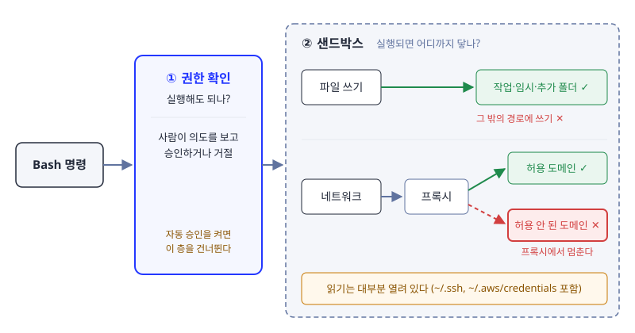

AI 코딩 에이전트를 쓰다 보면 확인 창이 너무 자주 뜬다. 그래서 샌드박스를 켜고 "샌드박스 안이면 묻지 말고 실행"으로 두는 경우가 많다. Claude Code는 11월 13일 2.1.325에서 이 기본값을 바꿨다. **샌드박스 안의 Bash 명령도 이제 기본으로 일반 권한 확인을 거친다**(Claude Code changelog 2.1.325).

이 글은 이 변경을 계기로 **샌드박스와 권한 확인이 각각 무엇을 막고, 무엇을 못 막는지** 정리한다. 둘은 같은 일을 하는 두 가지 방법이 아니라 다른 층이다.

## 문제 상황

변경 전에는 샌드박스를 켜면 샌드박스 안에서 도는 명령이 확인 없이 실행됐다. 바뀐 뒤에는 이렇다.

```json
{
  "sandbox": {
    "enabled": true,
    "autoAllowBashIfSandboxed": true
  }
}
```

예전처럼 묻지 않고 돌리려면 `sandbox.autoAllowBashIfSandboxed: true`를 직접 켜야 한다(같은 changelog). 조직이 관리형 설정으로 샌드박스를 켰다면, 이 값도 가장 우선순위가 높은 관리형 설정에 넣어야 한다.

"샌드박스가 있는데 왜 또 묻나?"가 자연스러운 반응이다. 답은 두 장치가 막는 대상이 다르기 때문이다. 명령 하나는 두 겹을 차례로 지난다.



## 1. 샌드박스가 막는 것: 실행된 뒤 닿는 범위

공식 문서는 샌드박스를 "Claude가 실행하는 셸 명령 주위에 운영체제가 강제하는 경계"라고 설명한다(Claude Code 문서 Sandboxing). 기본 동작은 이렇다.

- **파일 쓰기**: 작업 폴더, 사용자별 임시 폴더, 추가한 폴더까지만.
- **파일 읽기**: 기계의 대부분. 문서에 `~/.ssh`, `~/.aws/credentials` 같은 자격 증명 파일도 읽을 수 있다고 적혀 있다.
- **네트워크**: 직접 나가는 길이 없다. 로컬 프록시가 호스트를 허용 도메인 목록과 대조하고, 이 목록은 비어 있는 상태로 시작한다. 목록 밖 호스트로 가는 연결은 프록시에서 멈추고, 통과 여부는 권한 모드가 정한다.
- **범위 밖**: 내장 파일·웹 도구(Read, Edit, Write, WebFetch 등), 훅, MCP 서버는 샌드박스 밖에서 돈다.
- 샌드박스는 기본으로 꺼져 있다.

즉 샌드박스는 "**명령이 실행됐을 때 피해가 어디까지 번지나**"를 줄인다. 작업 폴더 밖을 지우거나, 허용하지 않은 서버로 바로 데이터를 보내는 일을 운영체제 수준에서 막는다.

## 2. 권한 확인이 막는 것: 실행 여부 자체

권한 확인은 "**이 명령을 지금 실행해도 되나**"를 사람이 판단하게 한다. 샌드박스가 못 보는 것을 본다.

- 작업 폴더 **안**에서 일어나는 파괴적인 일. `git reset --hard`, 마이그레이션 파일 삭제, 테스트 데이터 덮어쓰기는 전부 샌드박스가 허용하는 범위 안이다.
- 허용 도메인으로 나가는 요청. 허용 목록에 패키지 저장소나 사내 API를 넣었다면, 그쪽으로 무엇을 보내는지는 샌드박스가 구분하지 않는다.
- 의도. 명령이 문법상 안전해도 지금 작업과 상관없는 일이면 사람이 멈출 수 있다.

**샌드박스는 범위를, 권한 확인은 의도를 본다.** 문서도 두 모드에서 파일·네트워크 제한은 똑같고, 차이는 "자동 승인이냐 명시적 확인이냐"뿐이라고 적고 있다.

## 3. 같은 릴리스의 다른 변경들

2.1.325에는 같은 방향의 변경이 몇 개 더 있다(Claude Code changelog 2.1.325).

- 프로젝트 저장소도 아니고 신뢰한 저장소도 아닌 곳에서는 **읽기 전용 git 명령도 먼저 묻는다.**
- 예약 작업과 `/loop`가 `allowed-tools`나 훅을 선언한 스킬을 실행하기 전에 묻는다. 무인으로 돌리려면 `permissions.allow`에 `Skill(name)`을 넣어야 한다.
- 추가한 폴더 안의 `.claude` 설정·스킬·에이전트·훅에 대한 샌드박스 쓰기를 막는다. 시작 폴더에서 이미 막던 것을 추가 폴더에도 적용했다.

공통점은 "**무인 실행에서 묻지 않고 넘어가던 경로를 줄였다**"는 것이다. 특히 마지막 항목은 에이전트가 자기 설정을 고쳐 다음 실행의 권한을 넓히는 경로를 막는다.

## 주의 1. 자동 승인을 켜면 남는 방어선은 샌드박스뿐이다

`autoAllowBashIfSandboxed`를 켜는 것 자체가 틀린 선택은 아니다. 다만 켜는 순간 **작업 폴더 안의 실수와 허용 도메인으로의 전송은 아무도 확인하지 않는다.** 켜려면 아래가 갖춰져 있어야 한다.

- 작업 폴더가 git으로 관리되고, 되돌릴 수 있는 상태다.
- 허용 도메인 목록이 짧다. 넓은 와일드카드가 없다.
- 작업 폴더에 운영 자격 증명 파일이 없다.

## 주의 2. 읽기는 넓게 열려 있다

문서대로라면 기본 샌드박스에서 `~/.aws/credentials`는 **읽을 수 있다.** 막혀 있는 건 밖으로 보내는 길이다. 허용 도메인을 넓게 열면 "읽고, 허용된 곳으로 보내기"가 가능해진다. 네트워크 허용 목록을 손댈 때는 이 조합을 떠올려야 한다. 자격 증명 파일은 `sandbox.credentials`에 `"mode": "deny"`로 적어 샌드박스 명령의 읽기를 막을 수 있다(같은 문서).

## 실무에서는

- 처음에는 **샌드박스 켜기 + 기본값**(권한 확인 유지)으로 쓴다. 확인 창이 늘어난 만큼 무엇이 자주 묻는지 본다.
- 자주 묻는 안전한 명령은 자동 승인 전체가 아니라 **명령 단위 허용 규칙**으로 푼다.
- 예약 작업·`/loop`처럼 사람이 없는 실행은 필요한 스킬만 `Skill(name)`으로 허용한다.
- 리뷰 단계는 그대로 둔다. 권한 확인은 실행 직전 방어선이고, 결과물 검토는 [AI 코딩 에이전트와 코드 리뷰 병목](../ai-coding-review-bottleneck/)에서 본 것처럼 별도의 일이다.

## 정리

| 장치 | 보는 것 | 막는 것 | 못 막는 것 |
|---|---|---|---|
| 샌드박스 | 실행된 뒤 닿는 범위 | 작업 폴더 밖 쓰기, 허용 안 된 도메인으로 바로 나가기 | 작업 폴더 안 파괴, 허용 도메인으로 전송, 넓은 읽기 |
| 권한 확인 | 실행 여부·의도 | 지금 작업과 맞지 않는 명령 | 사람이 습관적으로 승인하는 경우 |
| 자동 승인(`autoAllowBashIfSandboxed`) | — | 확인 피로 | 위 두 겹 중 권한 확인을 끈다 |

**샌드박스는 권한 확인을 대신하지 않는다.** 이번 기본값 변경은 그 둘을 다시 분리해 놓은 것이다.

## 참고

- [Claude Code changelog](https://github.com/anthropics/claude-code/blob/main/CHANGELOG.md) (2.1.325)
- [Claude Code 문서: Sandboxing](https://code.claude.com/docs/en/sandboxing)
