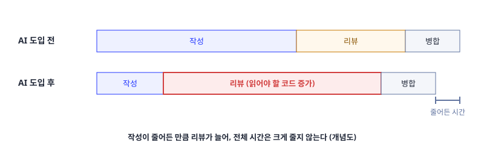

AI 코딩 에이전트를 쓰면 코드는 빨리 나온다. 그런데 일이 그만큼 빨리 끝나지는 않는다. 최근 여러 글과 연구에서 같은 이야기가 나왔다. **병목이 코드 작성에서 리뷰로 옮겨갔다**는 것이다.

이 글은 그 근거를 정리하고, 백엔드 코드를 리뷰할 때 특히 봐야 할 것과 리뷰 부담을 줄이는 방법을 정리한다.

## 문제 상황

코드를 쓰는 시간은 줄었다. 하지만 그 코드를 사람이 읽고, 확인하고, 병합하는 시간은 줄지 않았다. 오히려 읽어야 할 코드가 늘어서 리뷰가 길어졌다. 전체 시간은 생각만큼 줄지 않는다.

## 근거 1. 코드는 30% 늘었는데 완료된 일은 그대로

하버드 박사과정 연구자 두 명이 718개 기업을 분석한 워킹페이퍼가 있다.

- AI 코딩 에이전트를 도입한 회사의 엔지니어는 코드를 **약 30% 더** 썼다.
- 하지만 완료된 작업은 눈에 띄게 늘지 않았다.
- 코드가 리뷰를 통과하는 데는 **49% 더 오래** 걸렸다.

아직 동료 심사를 거치지 않은 논문이라 숫자 자체는 조심해서 봐야 한다. 그래도 방향은 현장에서 느끼는 것과 같다.

## 근거 2. 구현은 1시간, 검토는 반나절

일본 대기업 현장의 개발자가 쓴 글(요즘IT)에 따르면, 기능 명세서를 넘기면 구현과 단위 테스트까지 한 시간 안팎에 나온다. 그런데 그 초안을 읽고 고치는 데는 반나절 이상이 걸렸다.

검토에서 걸린 코드는 이런 것들이었다.

- 조회 권한이 없는데 있다고 가정한 코드
- 나중에 할 기능까지 미리 구현한 코드

결국 이 팀은 배포를 자동화 파이프라인 대신 사람이 단계별로 확인하는 방식으로 되돌렸다. 줄어든 구현 시간이 그대로 검토와 배포 확인으로 넘어간 셈이다.

## 근거 3. 세션을 늘리면 오히려 느려진다

AI 코딩 세션을 8~10개씩 동시에 돌려 본 개발자의 기록(요즘IT)도 있다. 규칙 없이 세션만 늘렸을 때는 개발 속도가 오히려 떨어졌다. 병목은 코드를 쓰는 AI가 아니라 **결정하고, 검토하고, 병합하는 사람**이었다.

이 개발자는 이슈 작성 규칙을 정하고, 전체를 관리하는 세션과 개발 세션을 나눴다. 그 뒤 주간 PR 머지가 29건에서 211건으로 늘었다. 세션 수가 아니라 **사람이 확인하는 흐름을 정리한 것**이 효과를 냈다.

## 근거 4. 리뷰만 하면 리뷰 실력도 떨어진다

반대 방향의 경고도 있다(GeekNews). 코드를 직접 쓰지 않고 지시와 리뷰만 하면 전문성을 유지하기 어렵다. 좋은 코드가 무엇인지, 바꾸기 쉬운 구조가 어떤 건지는 남이 쓴 코드를 읽는 것만으로는 몸에 붙지 않는다.

리뷰가 병목인데 리뷰어의 실력까지 떨어지면, 문제가 두 배가 된다.

## 백엔드 코드에서 특히 봐야 할 것

위 사례에서 걸린 코드는 백엔드에서 자주 보는 실수와 겹친다. 공통점은 **테스트와 CI를 통과해도 잘 드러나지 않는다**는 것이다.

| 항목 | 왜 놓치기 쉬운가 |
|---|---|
| 권한 가정 | 테스트 데이터가 대부분 권한 있는 사용자로 만들어져서, "당연히 조회할 수 있다"는 가정이 테스트에 안 걸린다 |
| 중복 실행·재시도 | 정상 흐름만 맞추고, 같은 일이 두 번 실행될 때를 놓친다. 외부 API 호출, 메시지 컨슈머, 스케줄러에서 특히 위험하다 |
| 동시성 | 혼자 실행하면 맞는 코드가 동시에 실행되면 틀린다. "조회 → 계산 → 저장" 패턴이 대표적이다 |
| 트랜잭션 경계 | 어디까지 한 트랜잭션인지는 코드 몇 줄 차이로 바뀌고, diff만 봐서는 잘 안 보인다 |
| 요청하지 않은 변경 | "나중에 필요할 것 같아서" 추가한 컬럼, 엔드포인트, 설정이 리뷰 범위와 장애 지점을 함께 늘린다 |

중복 실행은 [아웃박스 패턴의 멱등성과 재처리](../outbox-idempotency-and-reprocessing/), 동시성은 [재고 동시성 처리 방법](../inventory-concurrency-control/)에서 자세히 다뤘다.

## 리뷰 부담을 줄이는 방법

### 1. 리뷰할 범위를 처음부터 줄인다

작업을 작게 쪼개서 PR 하나에 변경 하나만 들어가게 한다. 지시할 때 **하지 말 것**도 같이 적는다. "이번 작업에서는 주문 테이블 스키마를 바꾸지 않는다" 같은 한 줄이 리뷰할 양을 크게 줄인다.

### 2. 사람이 확인할 지점을 미리 정한다

OpenAI가 공개한 Performance Factory가 좋은 예다.

에이전트에게 맡기는 단계와 사람이 보는 단계가 처음부터 나뉘어 있다. 사람은 모든 단계를 보지 않고, **수정안을 승인하는 한 지점**에 집중한다.

여기서 중요한 점은 "테스트와 CI를 통과했다"를 "완료"로 믿지 않는 것이다. 테스트를 다 통과했는데 화면을 열어 보니 기능이 빠져 있었다는 사례도 흔하다(요즘IT). 배포 후 확인 단계를 따로 두는 이유다.

### 3. 실행 범위를 좁힌다

리뷰를 아무리 잘해도, 에이전트가 실행하는 명령까지 하나하나 볼 수는 없다. 그래서 실행 환경 자체를 제한하는 쪽으로 가고 있다.

- OpenAI는 Codex가 명령을 실행할 때 사용자가 정한 파일과 네트워크 범위 안에서만 돌게 하는 샌드박스 구조를 공개했다.
- Simon Willison은 에이전트는 밖에 두고, 에이전트가 실행하는 코드만 별도 샌드박스에서 돌리는 패턴을 소개했다.

### 4. 직접 쓰는 시간을 남긴다

핵심 로직, 특히 돈이나 권한이 걸린 코드는 가끔이라도 직접 짠다. 리뷰 실력은 직접 써 본 경험에서 나온다.

## 정리

| 문제 | 대응 |
|---|---|
| 코드 양은 늘지만 완료되는 일은 그만큼 늘지 않는다 | 병목이 리뷰라는 걸 전제로 흐름을 설계한다 |
| 리뷰할 코드가 너무 많다 | 작게 쪼개고, 하지 말 것을 지시에 적는다 |
| 사람이 모든 단계를 볼 수 없다 | 사람이 확인할 지점을 미리 정하고, 테스트 통과를 완료로 믿지 않는다 |
| 에이전트의 실행을 다 검토할 수 없다 | 샌드박스로 실행 범위를 제한한다 |
| 리뷰만 하면 리뷰 실력이 떨어진다 | 핵심 로직은 직접 쓰는 시간을 남긴다 |

## 참고

- [Harvard researchers find AI coding agents shifted the bottleneck to code review](https://complexdiscovery.com/harvard-researchers-find-ai-coding-agents-shifted-the-bottleneck-to-code-review/) (ComplexDiscovery)
- [일본 개발 현장에서 달라진 것: 구현은 단 1시간, 검토는 반나절](https://yozm.wishket.com/magazine/detail/4036) (요즘IT)
- [AI 코딩 세션 10개를 동시에 관리하는 개발 워크플로우](https://yozm.wishket.com/magazine/detail/4043) (요즘IT)
- [AI가 "개발 완료"라고 하면, 어디까지 믿어도 될까](https://yozm.wishket.com/magazine/detail/4039) (요즘IT)
- [코드 작성을 멈추면 코드 리뷰 실력도 떨어진다](https://news.hada.io/topic?id=37534) (GeekNews)
- [How OpenAI's Performance Factory keeps ChatGPT fast](https://openai.com/index/how-openai-performance-factory-keeps-chatgpt-fast) (OpenAI)
- [Inside the Codex sandbox](https://openai.com/index/inside-the-codex-sandbox) (OpenAI)
- [External sandboxes for coding agents](https://simonwillison.net/2026/Nov/17/external-sandboxes-for-coding-agents/) (Simon Willison)
