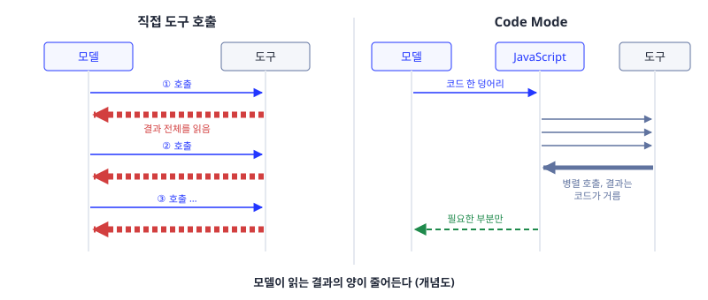

코딩 에이전트는 보통 도구를 하나 부르고, 결과를 읽고, 다음 도구를 고른다. 파일 20개를 같은 방식으로 고치면 이 왕복이 20번 이상 일어난다. Claude Code 가 2026년 11월 12일 2.1.323 에서 실험 기능으로 넣은 **Code Mode**는 이 왕복을 코드 한 덩어리로 바꾼다(Claude Code changelog). 이 글은 Code Mode 가 무엇이고, 어떻게 켜며, 어디에 쓸 만한지 정리한다.

## 문제 상황

에이전트가 도구를 직접 부르는 방식은 이렇다.

1. 검색 도구를 부른다.
2. 결과 전체를 읽는다.
3. 다음에 열 파일을 고른다.
4. 파일을 읽고, 고치고, 다시 다음 파일로.

매 단계에서 모델이 **결과 전체를 읽고 다음 행동을 정한다.** 판단이 필요한 작업에는 이게 맞다. 하지만 "검색 결과 중 테스트 파일만 남기기"나 "이 패턴을 모든 파일에서 바꾸기"처럼 규칙이 정해진 일까지 한 단계씩 왕복하면 느리고, 읽을 필요 없는 결과까지 읽게 된다.



## 1. Code Mode 는 무엇인가

문서의 설명은 한 문장이다. **Claude 가 JavaScript 를 작성해 여러 도구 호출을 한 단계에 실행하는 실험 기능**이다(Claude Code 문서, Code Mode). Claude 가 코드를 쓰고, Claude Code 가 세션 안에서 그 코드를 실행한다.

문서가 꼽는 장점은 세 가지다. 코드 하나가

- 명령을 **병렬로** 돌리고,
- 한 호출의 결과를 **다음 호출에 바로** 넘기고,
- 출력 중 **Claude 가 읽어야 할 부분만** 돌려준다.

즉 모델은 중간 결과를 하나하나 읽지 않고, 코드가 걸러 준 최종 결과만 본다. 문서가 권하는 작업도 이 성질에 맞는다. **여러 파일에 반복되는 변경**, **결과를 걸러서 읽어야 하는 검색**, **동시에 돌려도 되는 독립 명령 여러 개**다.

대화 화면에는 코드가 아니라 각 도구 호출(수정 diff 등)이 보인다. 코드를 보려면 `Ctrl+O`로 transcript 뷰어를 열고 **Code** 행을 펼친다.

문서에는 토큰이나 속도를 얼마나 줄이는지에 대한 수치가 없다. 효과는 작업마다 직접 재 봐야 한다.

## 2. 켜는 방법

기본값은 꺼짐이다. 환경 변수로 켠다.

```bash
CLAUDE_CODE_EXPERIMENTAL_CODE_MODE=1 claude
```

처음 켤 때 Claude Code 가 확인을 한 번 묻는다. 매번 켜려면 `~/.claude/settings.json`의 `env`에 같은 변수를 넣는다. 프로젝트 설정 파일에 넣은 값은 무시된다. 클론한 저장소가 Code Mode 를 대신 켤 수 없게 하려는 것이다.

요구 사항은 이렇다(문서 기준).

- Claude Code **v2.1.323 이상**, 네이티브 빌드
- 지원 모델: Claude Opus 5.5, Sonnet 5.5, Haiku 5.5, Fable 5.2
- **터미널의 대화형 세션에서만** 동작. VS Code 패널, 데스크톱 앱, 클라우드 세션에서는 안 된다.
- 게이트웨이를 거치면 쓸 수 없다. Amazon Bedrock, Microsoft Foundry 같은 클라우드 제공자는 문서에 "불가"로 적혀 있지만, 11월 23일 2.1.331 에서 이들 제공자의 터미널 세션 지원이 추가됐다(changelog).

## 3. 제약

실험 기능이라 제약이 많다. 문서가 밝힌 것만 옮긴다.

- 코드 실행은 **10분**이 지나면 멈춘다. 백그라운드로 돌리면 **최대 2시간**까지.
- Code Mode 세션은 **터미널에서, Code Mode 를 켠 상태로만** 이어서 열 수 있다.
- Remote Control, Claude in Chrome, computer use 를 함께 쓸 수 없다.
- 세션을 데스크톱 앱으로 옮기거나 백그라운드 세션으로 바꿀 수 없다.
- 문서 스스로 "언제든 바뀌거나 제거될 수 있다"고 적어 두었다.

## 4. 권한 검사가 보는 단위가 바뀐다

가장 눈여겨볼 대목이다. auto 모드에서는 분류기가 도구 호출을 하나씩 검사한다. Code Mode 에서는 **분류기가 도구 호출 하나하나가 아니라 코드를 검토한다**(문서).

검사 단위가 "호출 하나"에서 "호출 여러 개를 묶은 코드"로 커진다는 뜻이다. 문서는 한계도 밝힌다. 분류기는 **실행 중에 계산되는 값**, 예를 들어 검색 결과에서 꺼낸 경로를 보지 못한다. 그래서 반드시 막아야 하는 호출은 권한 규칙이나 훅으로 따로 지키라고 권한다.

다행히 `deny`·`ask` 권한 규칙과 `PreToolUse` 훅은 코드 안의 도구 호출 하나하나에 그대로 적용된다. 코드 자체를 먼저 읽고 승인하고 싶다면 코드를 실행하는 도구 `REPL`에 `ask` 규칙을 건다.

```json
{
  "permissions": {
    "ask": ["REPL"]
  }
}
```

권한 프롬프트를 직접 승인하는 습관이 있다면, **코드 전체를 읽고 승인하는지** 스스로 확인해야 한다.

## 실무에서는

- **켤 만한 작업**: 규칙이 명확한 일괄 변경, 결과가 큰 검색을 걸러 읽기, 서로 독립적인 명령 여러 개를 병렬로 돌리기.
- **끄고 할 작업**: 한 단계마다 판단이 필요한 디버깅, 설계 변경. 모델이 중간 결과를 직접 봐야 더 나은 다음 행동을 고른다.
- 실험 기능이니 **팀 기본값으로 켜지 않는다.** 개인 터미널에서 작업 단위로 켜 보고 차이를 재는 정도가 맞다. 조직에서 막으려면 managed settings 에 같은 변수를 `0`으로 둔다.
- 에이전트가 한 번에 더 많이 바꿀수록 리뷰 부담도 커진다. [AI 코딩 에이전트와 코드 리뷰 병목](../ai-coding-review-bottleneck/)에서 정리한 문제가 그대로 이어진다.

## 정리

| 항목 | 직접 도구 호출 | Code Mode |
|---|---|---|
| 실행 단위 | 도구 호출 하나 | 여러 호출을 묶은 JavaScript |
| 모델이 읽는 것 | 매 결과 전체 | 코드가 걸러 돌려준 부분 |
| 잘 맞는 작업 | 판단이 필요한 단계 | 반복 변경, 걸러 읽는 검색 |
| auto 모드 검사 | 호출마다 | 코드 단위 |
| 상태 | 기본 | 실험, 기본 꺼짐, v2.1.323+ |

## 참고

- [Run tool calls from code with Code Mode — Claude Code 문서](https://code.claude.com/docs/en/code-mode)
- [Claude Code changelog](https://code.claude.com/docs/en/changelog)
