[DB 락의 종류](../database-lock-types/)에서 비관적 락을, [재고 동시성 처리 방법](../inventory-concurrency-control/)에서 "여러 행을 잠글 때는 같은 순서로 잠가야 한다"고 짧게 적었다. 그 이유가 **데드락**이다.

이 글은 데드락이 생기는 대표적인 경우와 대응 방법을 정리한다. 예시는 MySQL/MariaDB(InnoDB)와 Spring Data JPA 기준이다.

## 문제 상황

두 사용자가 동시에 장바구니를 주문한다. 담은 상품은 같지만 순서가 다르다.

```sql
-- 트랜잭션 A
SELECT * FROM stock WHERE product_id = 1 FOR UPDATE;
SELECT * FROM stock WHERE product_id = 2 FOR UPDATE;  -- B 를 기다림

-- 트랜잭션 B
SELECT * FROM stock WHERE product_id = 2 FOR UPDATE;
SELECT * FROM stock WHERE product_id = 1 FOR UPDATE;  -- A 를 기다림
```

A 는 1번을 잡고 2번을 기다린다. B 는 2번을 잡고 1번을 기다린다. 둘 다 영원히 못 끝난다. InnoDB 는 이 원형 대기를 감지하면 **한쪽 트랜잭션을 강제로 롤백**한다. 애플리케이션에는 `Deadlock found when trying to get lock` 에러가 올라온다.



데드락은 버그라기보다 **동시성이 있으면 언젠가 생기는 현상**이다. 목표는 "절대 안 나게"가 아니라 "드물게 나고, 나도 안전하게"다.

## 1. 원인: 잠그는 순서가 다르다

가장 흔한 원인이다. 위 예시처럼 같은 행들을 서로 다른 순서로 잠근다.

- 대응: **항상 같은 순서로 잠근다.** 예를 들어 id 오름차순으로 정렬한 뒤 잠근다.

```kotlin
val productIds = orderItems.map { it.productId }.distinct().sorted()
val stocks = productIds.map { stockRepository.findByIdForUpdate(it) }
```

- 한 번에 `WHERE product_id IN (...) ORDER BY product_id FOR UPDATE` 로 잠가도 된다. 다만 실제 잠그는 순서는 실행 계획(어떤 인덱스를 타는지)에 달려 있으니 확인이 필요하다.

## 2. 원인: 생각보다 넓게 잠근다

인덱스가 없는 컬럼으로 `UPDATE ... WHERE` 를 하면 InnoDB 는 조건에 맞는 행만이 아니라 **스캔한 행 전부**에 락을 건다. 범위 조건이면 갭 락·넥스트키 락도 걸린다. 잠그는 범위가 넓을수록 다른 트랜잭션과 겹치기 쉽다.

- 대응: 락을 거는 쿼리의 조건 컬럼에 **인덱스**를 둔다. 가능하면 PK 나 유니크 키로 잠근다.
- 갭 락 개념은 [DB 락의 종류](../database-lock-types/)의 "락의 범위"를 참고한다.

## 3. 원인: 트랜잭션이 길다

트랜잭션 안에서 외부 API 를 부르거나 무거운 계산을 하면 락을 오래 쥔다. 쥐고 있는 시간이 길수록 다른 트랜잭션과 겹칠 확률이 커진다.

- 대응: 락을 잡은 구간에서는 DB 작업만 한다. 외부 호출은 커밋 뒤로 뺀다. [트랜잭셔널 아웃박스 패턴](../transactional-outbox-pattern/)이 이 분리를 해 주는 방법이다.

## 4. 그래도 나면: 재시도

순서를 맞추고 범위를 줄여도 0 이 되지는 않는다. 롤백된 쪽은 **처음부터 다시 실행하면** 대부분 성공한다.

```kotlin
@Retryable(
    retryFor = [PessimisticLockingFailureException::class],
    maxAttempts = 3,
    backoff = Backoff(delay = 50, multiplier = 2.0),
)
@Transactional
fun placeOrder(command: PlaceOrderCommand) { ... }
```

- 예시는 Spring Retry 2.x(`@EnableRetry` 필요) 기준이다. 데드락으로 롤백되면 Spring 은 `PessimisticLockingFailureException` 계열(`CannotAcquireLockException` 등) 예외로 바꿔 던지므로, 상위 타입으로 잡아 두면 변환 경로가 달라도 걸린다.
- 재시도는 **트랜잭션 바깥**에서 감싸야 한다. 이미 롤백된 트랜잭션 안에서 다시 시도하면 소용없다. 프록시 순서를 확인한다.
- 재시도해도 안전하려면 그 작업이 멱등해야 한다. 외부 호출이 섞여 있으면 [아웃박스에서 외부 API 중복 호출 막기](../outbox-idempotency-and-reprocessing/)처럼 멱등키가 필요하다.
- 데드락이 자주 나면 재시도로 덮지 말고 원인을 찾는다. MySQL/MariaDB 는 `SHOW ENGINE INNODB STATUS` 의 `LATEST DETECTED DEADLOCK` 에 마지막 데드락의 두 쿼리와 락이 나온다.

PostgreSQL 도 데드락을 감지해 한쪽을 롤백한다. 락을 `deadlock_timeout`(기본 1초)만큼 기다린 뒤에 검사한다는 점이 다르다.

## 정리

| 원인 | 대응 |
|---|---|
| 잠그는 순서가 다름 | id 오름차순 등 순서 고정 |
| 잠그는 범위가 넓음 | 조건 컬럼 인덱스, PK 로 잠금 |
| 트랜잭션이 김 | 락 구간에서는 DB 작업만, 외부 호출은 커밋 뒤 |
| 그래도 발생 | 트랜잭션 바깥에서 재시도 + 멱등성 |

실무에서는 **순서 고정과 짧은 트랜잭션으로 빈도를 낮추고, 남은 것은 재시도로 흡수**한다. 면접에서는 데드락의 조건(서로가 가진 자원을 기다림)과 "DB 가 한쪽을 롤백한다"는 동작, 순서 고정이라는 대응을 함께 설명하면 된다.

## 참고

- [PostgreSQL 문서: Lock Management (`deadlock_timeout`)](https://www.postgresql.org/docs/current/runtime-config-locks.html)
