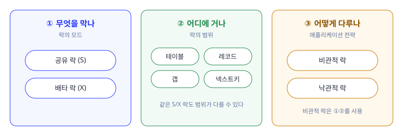
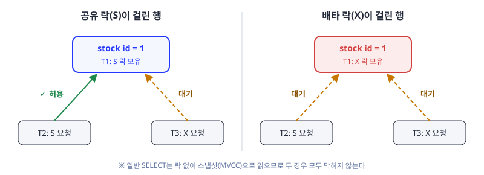
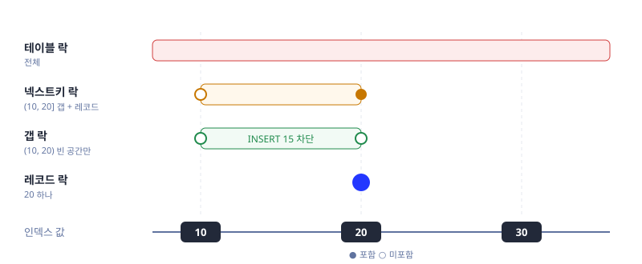
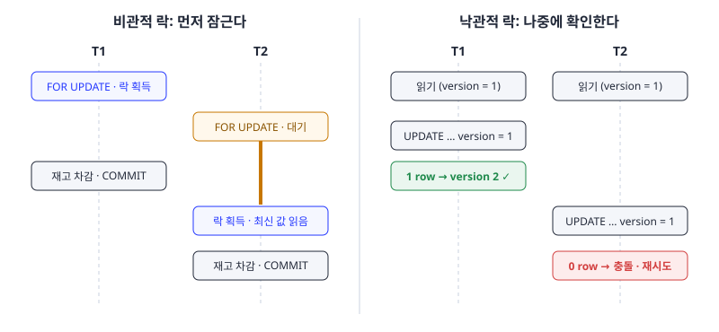

락 이름은 공유 락, 배타 락, 갭 락, 비관적 락처럼 많다. 헷갈리는 이유는 이 이름들이 **서로 다른 기준**으로 붙은 것이기 때문이다. 기준별로 나누면 정리가 쉽다.



예시 SQL과 동작은 MySQL/MariaDB의 InnoDB 기준이다. 다른 DB와 차이가 큰 부분은 따로 적었다.

## 1. 무엇을 막나: 공유 락과 배타 락

가장 기본이 되는 구분이다.

- **공유 락(S, Shared Lock):** "읽는 중이니 바꾸지 마"라는 락. 다른 트랜잭션도 공유 락을 같이 걸 수 있다. 하지만 배타 락은 기다려야 한다.
- **배타 락(X, Exclusive Lock):** "내가 바꿀 거니 아무도 건드리지 마"라는 락. 다른 트랜잭션은 공유 락이든 배타 락이든 모두 기다려야 한다.



| 이미 걸린 락 → / 새로 요청 ↓ | 공유 락(S) | 배타 락(X) |
|---|---|---|
| 공유 락(S) | 허용 | 대기 |
| 배타 락(X) | 대기 | 대기 |

SQL로는 이렇게 건다.

```sql
SELECT * FROM stock WHERE id = 1 FOR SHARE;          -- 공유 락 (MariaDB: LOCK IN SHARE MODE)
SELECT * FROM stock WHERE id = 1 FOR UPDATE;         -- 배타 락
UPDATE stock SET quantity = quantity - 1 WHERE id = 1; -- UPDATE/DELETE는 자동으로 배타 락
```

여기서 자주 하는 오해가 하나 있다. **평범한 `SELECT`는 락을 걸지 않는다.** InnoDB는 일반 조회를 스냅샷(MVCC)으로 처리하기 때문에, 배타 락이 걸린 행도 일반 `SELECT`로는 막힘 없이 읽힌다. "조회하고 그 값으로 수정하는" 로직에서 동시성 문제가 생기는 이유다. 이 경우는 `FOR UPDATE`로 읽어야 한다. 실제 사례는 [JPA Pessimistic Lock 으로 동시성 재고 처리](../jpa-pessimistic-lock/)에 정리했다.

**언제 쓰나**

- 공유 락: 읽은 값이 트랜잭션 끝까지 바뀌지 않아야 할 때. 예를 들어 주문을 넣는 동안 상품 행이 삭제되면 안 되는 경우.
- 배타 락: 읽은 값을 바탕으로 수정할 때. 재고 차감, 잔액 차감 같은 경우.

## 2. 어디에 거나: 락의 범위

같은 배타 락이라도 **얼마나 넓게 거느냐**에 따라 이름이 달라진다.



- **테이블 락:** 테이블 전체를 잠근다. `LOCK TABLES`나 DDL에서 쓰인다. 범위가 넓어 동시성이 크게 떨어진다.
- **레코드 락:** 인덱스 레코드 하나를 잠근다. 유니크 인덱스로 한 행을 정확히 찾을 때(`WHERE id = 20`) 걸린다.
- **갭 락:** 레코드 사이의 **빈 공간**을 잠근다. 그 사이에 새 행이 끼어드는 것(INSERT)을 막는다.
- **넥스트키 락:** 레코드 락 + 그 앞의 갭 락. InnoDB가 `REPEATABLE READ`에서 범위 조건(`WHERE id BETWEEN 10 AND 20`)을 잠글 때 기본으로 쓴다.

갭 락과 넥스트키 락이 필요한 이유는 **팬텀 리드(phantom read)** 때문이다. 같은 범위를 두 번 조회하는 사이에 다른 트랜잭션이 행을 끼워 넣으면 결과가 달라진다. 빈 공간까지 잠가서 이를 막는다.

주의할 점이 두 가지 있다.

- **InnoDB는 행이 아니라 인덱스를 잠근다.** 조건에 맞는 인덱스가 없으면 전체를 훑으면서 지나간 레코드를 모두 잠근다. 사실상 테이블 락처럼 동작한다. `FOR UPDATE`를 쓰는 쿼리는 인덱스를 꼭 확인한다.
- **갭 락은 InnoDB 특유의 동작이다.** `READ COMMITTED`에서는 대부분 쓰이지 않는다. PostgreSQL에는 갭 락이 없다.

## 3. 어떻게 다루나: 비관적 락과 낙관적 락

앞의 두 기준이 DB가 거는 락의 종류였다면, 이건 **애플리케이션이 충돌을 다루는 전략**이다.



- **비관적 락:** "충돌이 날 것"이라고 보고 **먼저 잠근다.** 앞에서 본 `FOR SHARE`, `FOR UPDATE`를 그대로 쓴다. 다른 트랜잭션은 기다린다.
- **낙관적 락:** "충돌은 드물 것"이라고 보고 **잠그지 않는다.** 대신 `version` 컬럼을 두고, 수정할 때 읽었던 version과 같은지 확인한다.

```sql
UPDATE stock
SET quantity = 9, version = 2
WHERE id = 1 AND version = 1;  -- 0 row면 누군가 먼저 수정한 것 → 다시 읽고 재시도
```

JPA에서는 `LockModeType`으로 고른다.

| JPA `LockModeType` | 실제 동작 | 분류 |
|---|---|---|
| `PESSIMISTIC_READ` | `SELECT … FOR SHARE` | 비관적 + 공유 락 |
| `PESSIMISTIC_WRITE` | `SELECT … FOR UPDATE` | 비관적 + 배타 락 |
| `OPTIMISTIC` (`@Version`) | 수정 시 `WHERE version = ?` 비교 | 낙관적 |

**어느 쪽을 고르나**

- 같은 행에 요청이 자주 몰린다면(인기 상품 재고) 비관적 락. 낙관적 락은 충돌할 때마다 재시도해서 오히려 느려진다.
- 충돌이 드물다면(내 프로필 수정) 낙관적 락. 대기 없이 처리되고 DB 락도 잡지 않는다.

## 참고: 서버 여러 대에서 DB 밖의 작업을 막아야 한다면

지금까지는 모두 DB 안의 행을 지키는 락이다. "스케줄링 작업을 서버 한 대에서만 실행"처럼 DB 행이 아닌 작업 자체를 막아야 한다면 Redis 같은 저장소를 쓰는 **분산 락**이 필요하다. 이 내용은 [ShedLock + Redis 글](../shedlock-redis-scheduled-job-lock/)에서 다뤘다.

## 정리

| 기준 | 종류 | 한 줄 요약 |
|---|---|---|
| 무엇을 막나 | 공유 락(S) | 읽기는 같이, 쓰기는 막음 |
| | 배타 락(X) | 읽기 락·쓰기 모두 막음 |
| 어디에 거나 | 레코드 락 | 인덱스 레코드 하나 |
| | 갭 락 | 레코드 사이 빈 공간 (INSERT 차단) |
| | 넥스트키 락 | 레코드 + 앞의 갭 |
| | 테이블 락 | 테이블 전체 |
| 어떻게 다루나 | 비관적 락 | 먼저 잠그고 기다리게 함 |
| | 낙관적 락 | 잠그지 않고 version으로 충돌 확인 |
