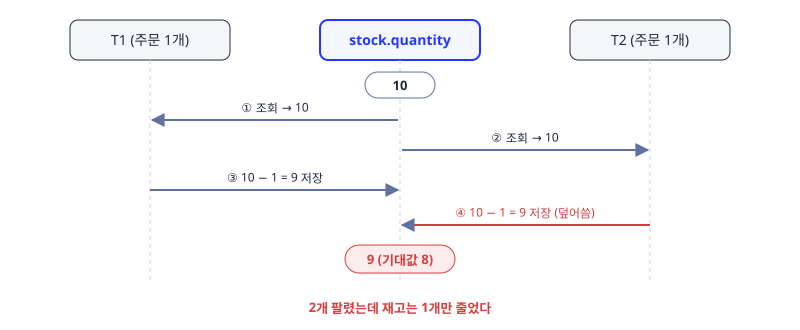
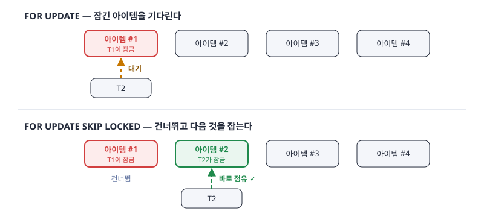
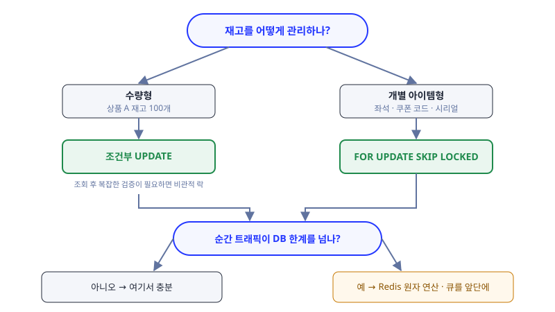

동시에 주문이 몰릴 때 재고가 틀어지는 문제와, 이를 처리하는 방법을 경우별로 정리한다. 각 방법마다 **서버가 여러 대인 환경에서도 동작하는지**를 함께 본다. 실제 서비스는 대부분 서버를 여러 대 띄우기 때문이다.

예시는 MySQL/MariaDB(InnoDB)와 Spring Data JPA 기준이다.

## 문제 상황

가장 흔한 구현은 이렇다.

```kotlin
@Transactional
fun order(productId: Long, quantity: Int) {
    val stock = stockRepository.findById(productId).orElseThrow()
    if (stock.quantity < quantity) throw SoldOutException()
    stock.quantity -= quantity   // 커밋 시점에 UPDATE
}
```

혼자 실행하면 문제없다. 하지만 두 요청이 동시에 들어오면 둘 다 같은 값을 읽고, 각자 계산한 값으로 덮어쓴다.



두 개가 팔렸는데 재고는 하나만 줄었다. 이를 **갱신 유실**(lost update)이라고 한다. 일반 `SELECT`는 락을 걸지 않기 때문에, 트랜잭션을 걸어도 막히지 않는다. (자세한 이유는 [DB 락의 종류](../database-lock-types/) 참고)

## 방법 1. synchronized

메서드에 `synchronized`를 붙여 한 번에 하나씩만 실행되게 한다.

- **다중 서버: 불가.** `synchronized`는 한 JVM 안에서만 동작한다. 서버 두 대에 요청이 나뉘면 그대로 동시에 실행된다.
- **서버 한 대여도 깨진다.** `@Transactional`은 프록시가 메서드 **바깥에서** 커밋한다. 메서드가 끝나 락이 풀린 뒤 커밋되기 전 틈에, 다음 스레드가 아직 커밋되지 않은 옛 값을 읽는다.

쓰면 안 되는 방법이다. 면접에서는 "왜 안 되는지"를 설명할 수 있는지가 핵심이다.

## 방법 2. 비관적 락

조회할 때부터 행을 잠근다. `SELECT … FOR UPDATE`로 읽으면, 다른 트랜잭션은 이 트랜잭션이 끝날 때까지 기다린다.

```kotlin
interface StockRepository : JpaRepository<Stock, Long> {
    @Lock(LockModeType.PESSIMISTIC_WRITE)
    @Query("SELECT s FROM Stock s WHERE s.id = :id")
    fun findByIdForUpdate(id: Long): Stock?
}
```

- **다중 서버: 가능.** 락을 DB가 관리하므로, 요청이 어느 서버로 들어오든 같은 행을 두고 줄을 선다.
- 장점: 확실하다. 조회 후 복잡한 검증(회원 등급별 구매 제한 등)이 필요해도 안전하다.
- 단점: 인기 상품에 요청이 몰리면 모두 기다린다. 여러 상품을 한 번에 잠글 때는 데드락이 생길 수 있어서 **항상 같은 순서(예: id 오름차순)로 잠가야** 한다.

## 방법 3. 낙관적 락

잠그지 않고, 저장할 때 "내가 읽은 뒤로 누가 바꿨는지"를 확인한다. 엔티티에 `@Version`을 붙이면 JPA가 `UPDATE … WHERE version = ?`으로 확인해 준다. 충돌하면 예외가 나고, 다시 읽어서 재시도한다.

- **다중 서버: 가능.** version 비교를 DB가 하므로 서버 대수와 상관없다.
- 장점: 락을 잡지 않아 충돌이 드물 때 빠르다.
- 단점: 재고처럼 **같은 행에 요청이 몰리는 곳에는 맞지 않는다.** 100명이 동시에 시도하면 1명만 성공하고 99명이 재시도한다. 재시도가 폭주한다.

## 실무에서는: 수량형 재고는 조건부 UPDATE

재고가 "상품 A 100개"처럼 숫자 하나라면, 사실 조회할 필요가 없다. **차감과 검사를 UPDATE 한 번에** 맡기면 된다.

```sql
UPDATE stock
SET quantity = quantity - :quantity
WHERE id = :id AND quantity >= :quantity;
```

```kotlin
@Modifying(clearAutomatically = true)
@Query("UPDATE Stock s SET s.quantity = s.quantity - :quantity WHERE s.id = :id AND s.quantity >= :quantity")
fun decrease(id: Long, quantity: Int): Int   // 0이면 품절

@Transactional
fun order(productId: Long, quantity: Int) {
    if (stockRepository.decrease(productId, quantity) == 0) throw SoldOutException()
}
```

- **다중 서버: 가능.** DB가 UPDATE 하나를 원자적으로 실행하므로, 어느 서버에서 동시에 와도 재고가 음수가 되거나 유실되지 않는다.
- 행 락은 UPDATE 순간에만 잡힌다. 조회 후 계산하는 비관적 락보다 잡는 시간이 짧다.
- 영향받은 행 수가 0이면 품절이다. 별도 조회가 필요 없다.

**수량형 재고라면 대부분 이것으로 충분하다.** 비관적 락은 조회 후 복잡한 검증이 꼭 필요할 때만 쓰면 된다.

## 실무에서는: 개별 아이템형 재고는 SKIP LOCKED

좌석, 쿠폰 코드, 시리얼 번호처럼 **남은 것 중 하나를 골라** 가져가는 재고도 있다. 이때 `FOR UPDATE`만 쓰면, 모든 요청이 같은 "첫 번째 남은 아이템"을 노리다가 줄을 선다.

`SKIP LOCKED`를 붙이면 **이미 누가 잡은 아이템은 건너뛰고** 다음 아이템을 바로 잡는다.



```sql
SELECT *
FROM stock_item
WHERE product_id = :productId AND status = 'AVAILABLE'
ORDER BY id
LIMIT 1
FOR UPDATE SKIP LOCKED;
```

- **다중 서버: 가능.** 어떤 아이템이 잠겼는지 DB가 알고 있으므로, 서버가 몇 대든 요청마다 서로 다른 아이템을 가져간다.
- 요청끼리 서로 기다리지 않는다.
- `(product_id, status)` 인덱스가 있어야 한다. 없으면 많은 행을 훑으며 잠근다.
- MySQL 8.0, MariaDB 10.6, PostgreSQL 9.5 이상에서 지원한다.

[JPA Pessimistic Lock 으로 동시성 재고 처리](../jpa-pessimistic-lock/) 글의 사례(남은 재고 중 하나를 판매 상태로 변경)가 바로 이 경우다. 지금 다시 구현한다면 `SKIP LOCKED`를 쓸 것이다.

## 트래픽이 DB 한계를 넘는 경우

선착순 이벤트처럼 짧은 시간에 요청이 수만 건 몰리면, 위 방법들도 결국 DB 한 행에 부하가 집중된다. 이때는 DB 앞에서 먼저 걸러 낸다.

- **Redis 원자 연산:** Redis의 `DECR`은 원자적이다. 재고 수를 Redis에 두고 `DECR` 결과가 0 이상인 요청만 DB로 보낸다. 모든 서버가 같은 Redis를 보므로 다중 서버에서도 동작한다. 대신 Redis와 DB의 재고가 어긋날 때 맞추는 방법(장애 시 복구, 주문 실패 시 되돌리기)을 함께 설계해야 한다.
- **큐로 줄 세우기:** 주문 요청을 큐에 넣고, 상품별로 하나씩 순서대로 처리한다. 경합 자체가 사라진다. 대신 사용자는 결과를 바로 받지 못하고 "처리 중" 상태를 거친다.

두 방법 모두 복잡도가 크게 올라가니, 실제로 DB가 감당하지 못할 때 도입한다.

### 분산 락(Redisson)은?

자주 나오는 답이지만, 재고 차감만을 위해서라면 권하지 않는다. DB가 이미 행 락으로 동시 수정을 조율하고 있어서, 그 앞에 락을 하나 더 두면 네트워크 왕복과 실패 지점만 늘어난다. 락 만료 시간과 커밋 순서도 신경 써야 한다. 분산 락은 DB 밖의 작업을 막아야 할 때 쓴다. ([ShedLock + Redis 글](../shedlock-redis-scheduled-job-lock/) 참고)

## 정리



| 방법 | 다중 서버 | 언제 쓰나 |
|---|---|---|
| `synchronized` | 불가 | 쓰지 않는다 |
| 비관적 락 | 가능 | 조회 후 복잡한 검증이 필요할 때 |
| 낙관적 락 | 가능 | 충돌이 드문 수정 (재고에는 부적합) |
| 조건부 UPDATE | 가능 | **수량형 재고의 기본값** |
| `FOR UPDATE SKIP LOCKED` | 가능 | **개별 아이템형 재고의 기본값** |
| Redis 원자 연산 / 큐 | 가능 | 순간 트래픽이 DB 한계를 넘을 때 앞단에 추가 |

다중 서버에서 동작하는 방법들의 공통점은 **동시성 판단을 서버가 아니라 DB(또는 Redis)라는 한 곳에 맡긴다**는 것이다. 서버를 몇 대로 늘려도 판단하는 곳이 하나라서 결과가 어긋나지 않는다.
