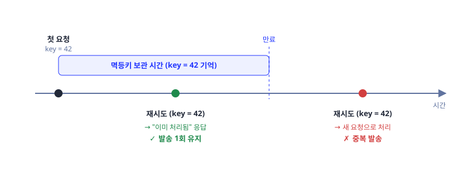

[이전 글](../transactional-outbox-pattern/)에서 트랜잭셔널 아웃박스로 메시지 유실을 막았다. 대신 아웃박스는 같은 메시지를 **두 번 보낼 수 있다.** 서버가 죽거나 큐가 메시지를 다시 주면, 컨슈머는 같은 메시지를 또 받는다.

이전 글에서는 상태 확인과 조건부 갱신으로 이 중복을 막았다. 그런데 이 방법으로도 막지 못하는 경우가 하나 있다. 이 글은 그 경우와 해결 방법을 다룬다.

## 알림이 두 번 가는 순간

컨슈머가 외부 API를 호출해 알림을 보낸 직후, 상태를 SENT로 바꾸기 전에 죽는 경우다.



1. 컨슈머가 상태를 확인한다. PENDING이다.
2. 외부 API를 호출한다. 알림이 나간다.
3. SENT로 바꾸기 전에 서버가 죽는다.
4. 메시지가 다시 전달된다. 상태는 아직 PENDING이다.
5. 컨슈머는 처음 받은 메시지라고 판단하고, 외부 API를 또 호출한다.

고객은 같은 알림을 두 번 받는다.

조건부 갱신은 "DB에 두 번 기록되는 것"을 막는다. 하지만 여기서는 기록 자체가 한 번도 안 됐다. DB만 봐서는 알림이 이미 나갔는지 알 방법이 없다. **이미 보냈는지는 외부 시스템만 안다.**

## 해결: 외부 API에 멱등키 보내기

멱등키(idempotency key)는 "이 요청은 이 키로 이미 보냈다"를 외부 시스템이 기억하게 하는 값이다. 같은 키로 요청이 다시 오면, 외부 시스템은 처리하지 않고 "이미 처리됨"이라고 응답한다.

키는 **다시 보내도 바뀌지 않는 값**이어야 한다. 아웃박스 행 ID가 딱 맞다. 같은 알림이면 몇 번을 다시 보내도 ID는 같다. 반대로 요청할 때마다 새로 만드는 UUID는 쓸모없다. 재시도할 때마다 키가 달라지니 외부 시스템이 같은 요청인지 알 수 없다.

```kotlin
package com.example.notification.application

fun deliver(outbox: NotificationOutbox) {
    val result = vendorClient.send(
        request = outbox.toRequest(),
        idempotencyKey = "notification-${outbox.id}",
    )
    when (result) {
        is SendResult.Sent,
        is SendResult.AlreadyProcessed -> outboxRepository.markSentIfPending(outbox.id)
        is SendResult.Failed -> handleFailure(outbox, result)
    }
}
```

"이미 처리됨(`AlreadyProcessed`)"도 성공으로 본다는 점이 중요하다. 위 시나리오의 5단계에서 외부 API는 "이미 처리됨"을 돌려주고, 컨슈머는 그때 SENT로 기록한다. 알림은 한 번만 나간다.

## 주의: 멱등키는 영원히 기억되지 않는다

외부 시스템은 멱등키를 일정 시간만 기억한다. 그 시간이 지나면 같은 키로 와도 새 요청으로 처리한다.



그래서 재처리 규칙은 두 가지다.

- **자동 재시도는 보관 시간 안에 끝낸다.** 재시도 간격과 큐의 재전달 대기 시간(가시성 타임아웃)을 합쳐도 보관 시간을 넘지 않게 잡는다.
- **보관 시간이 지나서 다시 보낼 때는 먼저 확인한다.** DLQ에 쌓인 메시지를 나중에 다시 처리하는 경우가 대표적이다. 멱등키가 이미 만료됐을 수 있으니, 외부의 조회 API로 실제로 나갔는지 확인한 뒤 보낸다.

실무에서 연동하던 외부 서비스를 바꿨을 때, 멱등키 보관 시간이 하루에서 10분으로 줄었다. 기존 재시도 간격이 10분을 넘었기 때문에 재시도 정책을 다시 잡아야 했다. 외부 API를 연동할 때는 멱등키 지원 여부만이 아니라 **보관 시간이 얼마인지**도 반드시 확인해야 한다.

## 정리

- 아웃박스에서 중복 메시지는 피할 수 없다.
- DB 조건부 갱신은 기록 중복을 막지만, 외부 API 중복 호출은 막지 못한다.
- 외부 API에는 아웃박스 행 ID 같은 고정값을 멱등키로 보낸다.
- 멱등키는 보관 시간 안에서만 효과가 있다. 재시도는 그 안에서 끝내고, 그 뒤의 재처리는 확인부터 한다.
