[DB 락의 종류](../database-lock-types/)에서 다룬 락은 모두 **이미 있는 행**을 지킨다. 그런데 잠글 행이 아직 없거나, 행이 아니라 "작업" 자체를 한 번에 하나만 돌려야 할 때가 있다.

[ShedLock 글](../shedlock-redis-scheduled-job-lock/)에서는 이런 경우 Redis 분산 락을 골랐다. 그 글에서 "잡이 늘면 결국 advisory lock과 lease를 직접 만들게 된다"고 썼다. 이 글은 그 **PostgreSQL advisory lock**을 정리한다. Redis 없이 DB만으로 직렬화하는 방법이다.

예시는 PostgreSQL과 Spring(JdbcTemplate), Kotlin 기준이다.

## 문제 상황

고객별로 "첫 주문이면 웰컴 쿠폰을 발급"하는 로직이 있다고 하자.

```kotlin
@Transactional
fun placeOrder(customerId: Long, request: OrderRequest) {
    val isFirst = orderRepository.countByCustomerId(customerId) == 0L
    orderRepository.save(Order(customerId, request))
    if (isFirst) couponService.issueWelcome(customerId)
}
```

같은 고객의 주문 두 건이 동시에 들어오면 둘 다 `count == 0`을 본다. **쿠폰이 두 번 나간다.**

`SELECT ... FOR UPDATE`로 막고 싶은데, 첫 주문 전에는 **잠글 주문 행이 없다.** 고객 행을 잠그면 되지만, 고객 행이 다른 서비스 소유이거나 자주 갱신되는 행이라 잠그기 부담스러울 수 있다.

## 방법 1. 부모 행을 FOR UPDATE

- **다중 서버: 가능**
- 장점: 표준 SQL이다. 트랜잭션이 끝나면 자동으로 풀린다.
- 단점: 잠글 부모 행이 있어야 한다. 그 행을 쓰는 다른 업데이트도 같이 막힌다.

```sql
SELECT id FROM customer WHERE id = :customerId FOR UPDATE;
```

부모 행이 확실히 있고, 그 행을 잠가도 다른 기능에 영향이 적으면 이게 가장 단순하다.

## 방법 2. 세션 advisory lock

- **다중 서버: 가능**
- 장점: 행과 상관없이 정수 키 하나를 잠근다.
- 단점: **커밋해도 안 풀린다.** 직접 `pg_advisory_unlock`을 불러야 한다. 커넥션 풀과 같이 쓰면 위험하다.

```sql
SELECT pg_advisory_lock(42);
-- 작업
SELECT pg_advisory_unlock(42);
```

advisory lock은 PostgreSQL이 의미를 모르는 락이다. **키(bigint 하나 또는 int 두 개)의 의미는 애플리케이션이 정한다.** 같은 키를 부른 세션끼리만 서로 기다린다.

문제는 커넥션 풀이다. HikariCP 같은 풀은 커넥션을 닫지 않고 돌려쓴다. 예외로 `unlock`을 건너뛰면 **락을 쥔 커넥션이 풀로 돌아간다.** 그 커넥션은 계속 락을 가지고 있고, 다른 커넥션에서 같은 키를 부르는 요청은 계속 기다린다.

## 방법 3. 트랜잭션 advisory lock

- **다중 서버: 가능**
- 장점: 커밋·롤백 때 자동으로 풀린다. 풀 누수 걱정이 없다.
- 단점: 트랜잭션 밖에서는 의미가 없다. 트랜잭션이 길면 락도 길게 잡힌다.

```kotlin
@Transactional
fun placeOrder(customerId: Long, request: OrderRequest) {
    jdbcTemplate.queryForList(
        "SELECT pg_advisory_xact_lock(?, ?)",
        LockNamespace.WELCOME_COUPON, Math.toIntExact(customerId),
    )
    val isFirst = orderRepository.countByCustomerId(customerId) == 0L
    orderRepository.save(Order(customerId, request))
    if (isFirst) couponService.issueWelcome(customerId)
}
```

키는 int 두 개 버전을 썼다. 첫 번째는 용도, 두 번째는 고객 ID다. 고객 ID가 int 범위를 넘을 수 있으면 `toIntExact`가 예외를 던지므로, 그때는 bigint 하나짜리 버전에 ID를 그대로 넣는다(대신 용도 구분은 사라진다).

`pg_advisory_xact_lock`은 **같은 트랜잭션 안에서** 불러야 한다. Spring의 `@Transactional`이 JdbcTemplate과 JPA에 같은 커넥션을 쓰게 해 주므로 위 코드는 한 트랜잭션이다.

두 번째 주문 요청은 첫 요청이 커밋할 때까지 기다린다. 풀리고 나면 `count`가 1이라 쿠폰을 건너뛴다.



## 방법 4. try 버전으로 "이미 누가 하고 있으면 건너뛰기"

- **다중 서버: 가능**
- 장점: 기다리지 않는다. 스케줄 잡을 한 대에서만 돌리는 데 쓸 수 있다.
- 단점: 못 잡으면 그냥 넘어가므로, 반드시 해야 하는 작업에는 맞지 않다.

```kotlin
@Transactional
fun runDailySync() {
    val acquired = jdbcTemplate.queryForObject(
        "SELECT pg_try_advisory_xact_lock(?, ?)",
        Boolean::class.java,
        LockNamespace.JOB, JobId.DAILY_SYNC,
    )
    if (acquired != true) return
    // 동기화 작업
}
```

ShedLock이 하는 "한 대만 실행"을 DB 함수 하나로 흉내 낸 셈이다. 다만 ShedLock처럼 "최소 유지 시간"은 없다. 잡이 빨리 끝나면 다른 서버가 곧바로 같은 회차를 다시 돌 수 있다.

## 실무에서 주의할 점

- **키 충돌.** 문자열을 `hashtext()`로 바꿔 쓰면 32비트라 다른 문자열이 같은 키가 될 수 있다. int 두 개 버전을 쓰고 첫 번째 값을 용도(네임스페이스)로 고정하면 기능끼리 키가 섞이지 않는다.
- **PgBouncer transaction 모드.** 트랜잭션마다 서버 커넥션이 바뀐다. 세션 락은 엉뚱한 곳에 남는다. **트랜잭션 락만 쓴다.**
- **트랜잭션 길이 = 락 길이.** 락 안에서 외부 API를 부르면 그동안 같은 키의 요청이 모두 기다린다. [트랜잭션 안의 외부 API 호출](../transactional-external-api-call/) 문제와 같은 구조다.
- **DB를 바꿀 수 없다.** PostgreSQL 전용 함수다. MySQL에도 `GET_LOCK`이 있지만 세션 단위라 방법 2의 주의가 그대로 적용된다.
- **Flyway도 이걸 쓴다.** PostgreSQL에서는 `pg_advisory_lock`으로 동시 migrate를 직렬화한다. 서버 여러 대가 동시에 부팅해도 마이그레이션이 한 번만 도는 이유다([운영 DB에 Flyway 처음 도입하기](../flyway-production-introduction/)).

단순 채번이나 카운터처럼 한 문장으로 끝나는 일이라면 락보다 [atomic upsert](../postgres-atomic-upsert-sequence-numbering/)가 낫다. advisory lock은 **"읽고 판단하고 쓰는" 여러 단계를 키 단위로 묶어야 할 때** 꺼낸다.

## 정리

| 방법 | 잠그는 대상 | 풀리는 시점 | 기다림 | 맞는 상황 |
|---|---|---|---|---|
| FOR UPDATE | 이미 있는 행 | 트랜잭션 끝 | 기다림 | 부모 행이 확실히 있을 때 |
| 세션 advisory lock | 정수 키 | 직접 unlock | 기다림 | 풀 없는 단독 커넥션 |
| 트랜잭션 advisory lock | 정수 키 | 트랜잭션 끝 | 기다림 | 행 없는 작업 직렬화 |
| try 트랜잭션 advisory lock | 정수 키 | 트랜잭션 끝 | 건너뜀 | 스케줄 잡 단일 실행 |

실무 기본값은 **트랜잭션 advisory lock + int 두 개 키**다. 세션 락은 풀을 거치지 않는 커넥션이 아니면 쓰지 않는다.
