서버 세 대 중 한 대만 사양이 높다. 요청을 그 서버에 더 많이 보내고 싶다. 가장 쉬운 방법은 가중치만큼 순서를 펼치는 것인데, 이러면 **한 서버에 요청이 연달아 몰린다.**

이 글은 가중치는 지키면서 순서를 고르게 섞는 **Smooth Weighted Round Robin**(이하 SWRR)을 정리한다. nginx `upstream`의 `weight`가 이 방식이다. 코드는 Kotlin이다.

## 문제 상황

서버 A, B, C의 가중치가 5, 1, 1이라고 하자. 7번 중 A에 5번, B와 C에 1번씩 보내야 한다.

가중치를 그대로 펼치면 순서는 이렇다.

```text
A A A A A B C | A A A A A B C | ...
```

비율은 맞다. 하지만 A는 5번 연속으로 받고, B와 C는 그동안 논다. 짧은 순간만 보면 **A만 일하는 구간**이 생긴다. 요청이 무거우면 A의 응답 시간이 튄다.

원하는 건 이런 순서다.

```text
A A B A C A A | A A B A C A A | ...
```

비율은 같은데 A 사이에 B와 C가 끼어 있다.

## 방법 1. 단순 라운드 로빈

- **가중치: 반영 안 됨**
- 장점: 구현이 한 줄이다. 순서가 완전히 고르다.
- 단점: 사양이 다른 서버를 똑같이 취급한다.

```kotlin
class RoundRobin<T>(private val items: List<T>) {
    private var index = 0

    @Synchronized
    fun next(): T = items[index++ % items.size]
}
```

서버 사양이 모두 같다면 이걸로 충분하다.

## 방법 2. 가중치만큼 펼치기

- **가중치: 반영됨, 몰림: 있음**
- 장점: 방법 1을 그대로 재사용한다.
- 단점: 같은 서버가 연달아 뽑힌다. 가중치 합이 크면(예: 100) 목록도 커진다.

```kotlin
val expanded = weights.flatMap { (server, weight) -> List(weight) { server } }
val balancer = RoundRobin(expanded)
```

## 방법 3. 가중치 랜덤

- **가중치: 평균적으로 반영, 몰림: 확률적으로 있음**
- 장점: 상태가 없다. 서버 여러 대가 각자 돌려도 된다.
- 단점: 짧은 구간에서는 비율이 흔들린다. 같은 서버가 연달아 나올 수 있다.

```kotlin
fun pick(weights: Map<String, Int>): String {
    var r = Random.nextInt(weights.values.sum())
    for ((server, weight) in weights) {
        if (r < weight) return server
        r -= weight
    }
    error("unreachable")
}
```

요청 수가 많으면 평균은 맞는다. 상태를 공유하기 어려운 환경에서 고른다.

## 방법 4. Smooth Weighted Round Robin

- **가중치: 정확히 반영, 몰림: 최소**
- 장점: 가중치 합만큼 뽑으면 비율이 정확히 맞는다. 순서가 고르게 섞인다.
- 단점: 서버마다 상태(`current`)를 들고 있어야 한다. 매번 전체를 훑는다(O(n)).

규칙은 세 줄이다.

1. 모든 서버의 `current`에 자기 `weight`를 더한다.
2. `current`가 가장 큰 서버를 뽑는다.
3. 뽑힌 서버의 `current`에서 가중치 합(`total`)을 뺀다.

```kotlin
class SmoothWeightedRoundRobin<T>(weights: Map<T, Int>) {
    private class Node<T>(val item: T, val weight: Int) {
        var current = 0
    }

    private val nodes = weights.map { (item, weight) ->
        require(weight > 0) { "weight must be positive: $item=$weight" }
        Node(item, weight)
    }
    private val total = nodes.sumOf { it.weight }

    @Synchronized
    fun next(): T {
        nodes.forEach { it.current += it.weight }
        val selected = nodes.maxBy { it.current }
        selected.current -= total
        return selected.item
    }
}
```

A=5, B=1, C=1로 따라가 보면 이렇다. `total`은 7이다.

| 회차 | 더한 뒤 (A, B, C) | 뽑힘 | 뺀 뒤 (A, B, C) |
|---|---|---|---|
| 1 | 5, 1, 1 | A | -2, 1, 1 |
| 2 | 3, 2, 2 | A | -4, 2, 2 |
| 3 | 1, 3, 3 | B | 1, -4, 3 |
| 4 | 6, -3, 4 | A | -1, -3, 4 |
| 5 | 4, -2, 5 | C | 4, -2, -2 |
| 6 | 9, -1, -1 | A | 2, -1, -1 |
| 7 | 7, 0, 0 | A | 0, 0, 0 |



7번째가 끝나면 모두 0으로 돌아온다. **한 바퀴(가중치 합만큼)마다 상태가 처음으로 되돌아간다.** 매 회차 더하는 양도 `total`, 빼는 양도 `total`이라 합이 항상 0이기 때문이다.

직관은 이렇다. 가중치가 큰 서버는 `current`가 빨리 차오른다. 대신 뽑히면 크게 깎여서 한동안 밀린다. 그 사이 작은 서버들이 차례를 받는다.

## 실무에서는

- **로드밸런서를 직접 만들 일은 드물다.** nginx는 `upstream`의 `weight`로 이 방식을 쓴다. 클라우드 로드밸런서도 가중치 설정을 제공한다.
- **직접 쓸 일은 애플리케이션 안쪽에 있다.** 외부 API 키 여러 개를 한도 비율대로 나눠 쓰기, 읽기 전용 복제본 여러 대에 쿼리 나누기, 카나리 비율로 기능 분기하기 같은 경우다.
- **상태는 인스턴스마다 따로다.** 서버가 여러 대면 각자 SWRR을 돌린다. 각 인스턴스 안에서는 비율이 맞으니 전체 합도 비율에 가깝다. 인스턴스끼리 순서를 맞출 필요가 없다면 상태가 없는 방법 3도 된다. 정확한 전역 순서가 필요하면 중앙 저장소에 상태를 둔다.
- **가중치를 바꾸면 `current`를 0으로 초기화한다.** 이전 상태가 남아 있으면 한 바퀴 동안 비율이 어긋난다.

## 정리

| 방법 | 가중치 | 순서 몰림 | 상태 | 비용 |
|---|---|---|---|---|
| 단순 라운드 로빈 | 무시 | 없음 | 인덱스 하나 | O(1) |
| 펼치기 | 반영 | 큼 | 인덱스 하나 | O(1), 목록 크기 = 가중치 합 |
| 가중치 랜덤 | 평균 반영 | 확률적 | 없음 | O(n) |
| Smooth WRR | 정확 반영 | 최소 | 서버별 current | O(n) |

가중치를 지키면서 한 서버로 몰리지 않게 하려면 **더하고, 가장 큰 걸 뽑고, 합만큼 뺀다.** 면접에서는 "왜 한 바퀴마다 0으로 돌아오는가"를 설명할 수 있으면 충분하다.
