외부 API는 보통 "초당 N회" 같은 호출 제한이 있다. 우리 API도 특정 사용자가 요청을 몰아 보내면 다른 사용자까지 느려진다. 이럴 때 쓰는 대표적인 방법이 **토큰 버킷**(token bucket)이다.

이 글은 토큰 버킷의 원리와 Kotlin 구현, 서버가 여러 대일 때 적용하는 방법을 정리한다.

## 문제 상황

가장 쉬운 방법은 "1초마다 카운터를 0으로 초기화하고, 100을 넘으면 거절"하는 **고정 윈도우**다.

```text
0.9초에 100건 → 통과
1.1초에 100건 → 통과 (새 윈도우)
→ 0.2초 사이에 200건이 들어간다
```

윈도우 경계에서 한도의 두 배가 통과한다. 반대로 순간적인 몰림(burst)을 어느 정도는 허용하고 싶을 때도 있다. 토큰 버킷은 이 두 가지를 숫자 두 개로 조절한다.

## 1. 원리: 용량과 충전 속도

- 버킷에는 최대 **용량**(capacity)만큼 토큰이 들어간다.
- 토큰은 일정한 **충전 속도**(refill rate)로 채워진다. 가득 차면 더 쌓이지 않는다.
- 요청 하나가 토큰 하나를 쓴다. 토큰이 없으면 거절한다.



용량은 **한 번에 몰려도 되는 양**, 충전 속도는 **평균적으로 허용하는 속도**다. 용량 10, 초당 5개라면 쉬던 사용자는 10건을 한 번에 보낼 수 있고, 그 뒤로는 초당 5건으로 제한된다.

타이머로 토큰을 채울 필요는 없다. 요청이 올 때 "마지막 충전 이후 지난 시간 × 충전 속도"만큼 한 번에 더하면 된다.

## 2. Kotlin 구현

```kotlin
class TokenBucket(
    private val capacity: Long,
    private val refillTokensPerSecond: Double,
    private val nanoClock: () -> Long = System::nanoTime,
) {
    private var tokens: Double = capacity.toDouble()
    private var lastRefillNanos: Long = nanoClock()

    @Synchronized
    fun tryConsume(): Boolean {
        refill()
        if (tokens < 1.0) return false
        tokens -= 1.0
        return true
    }

    private fun refill() {
        val now = nanoClock()
        val elapsedSeconds = (now - lastRefillNanos) / 1_000_000_000.0
        tokens = minOf(capacity.toDouble(), tokens + elapsedSeconds * refillTokensPerSecond)
        lastRefillNanos = now
    }
}
```

- `System.nanoTime()`을 쓴다. 벽시계(`currentTimeMillis`)는 NTP 보정으로 뒤로 갈 수 있다.
- 시계를 주입받으면 테스트에서 시간을 직접 움직일 수 있다.
- `@Synchronized`는 한 JVM 안에서만 유효하다. 사용자별로 버킷을 두려면 `ConcurrentHashMap<UserId, TokenBucket>`에 담는다.

## 3. 다중 서버에서는

서버가 여러 대면 각 서버의 버킷이 따로 논다. 서버 3대면 사실상 한도가 3배가 된다. 방법은 두 가지다.

### 방법 1. 서버별 한도를 나눠 잡기

- **다중 서버: 가능(근사).** 전체 한도 ÷ 서버 수로 각자 제한한다.
- 장점: 외부 저장소가 필요 없다.
- 단점: 오토스케일로 서버 수가 바뀌면 한도가 흔들린다. 로드밸런서가 고르게 나누지 않으면 정확하지 않다.

### 방법 2. Redis 에 버킷 상태 두기

- **다중 서버: 가능.** 토큰 수와 마지막 충전 시각을 Redis 에 두고, 충전과 차감을 **Lua 스크립트 하나로 원자적으로** 처리한다.
- 장점: 서버 수와 상관없이 한도가 정확하다.
- 단점: 요청마다 Redis 왕복이 생긴다. Redis 가 죽었을 때 통과시킬지 막을지(fail-open/fail-closed) 정해야 한다.

조회와 차감을 따로 보내면 그 사이에 다른 서버가 끼어든다. 이건 [재고 동시성 처리 방법](../inventory-concurrency-control/)에서 본 갱신 유실과 같은 문제다. 직접 구현보다 Bucket4j 같은 라이브러리를 먼저 검토하는 편이 낫다.

## 정리

| 방식 | 경계 문제 | 순간 몰림 허용 | 구현 |
|---|---|---|---|
| 고정 윈도우 | 있음 (최대 2배) | 제어 안 됨 | 가장 쉬움 |
| 토큰 버킷 | 없음 | 용량으로 조절 | 쉬움 |

실무에서는 **용량은 허용할 순간 몰림, 충전 속도는 평균 한도**로 정하고, 서버가 여러 대면 Redis 원자 연산이나 검증된 라이브러리로 상태를 공유한다. 면접에서는 고정 윈도우의 경계 문제와 토큰 버킷의 두 파라미터를 설명할 수 있으면 된다.
