트랜잭션을 걸면 동시성 문제가 사라진다고 생각하기 쉽다. 실제로 무엇을 막는지는 **격리 수준**이 정하고, 같은 이름의 격리 수준도 DB마다 다르게 동작한다.

이 글은 격리 수준 네 가지와, 가장 많이 쓰는 MySQL(InnoDB)과 PostgreSQL의 차이를 정리한다. ACID 중 I(격리성)를 더 깊게 보는 글이다. (ACID 전체는 [트랜잭션과 ACID](../transaction-acid/) 참고)

## 문제 상황

[재고 동시성 처리 방법](../inventory-concurrency-control/)에서 본 코드다.

```kotlin
@Transactional
fun order(productId: Long, quantity: Int) {
    val stock = stockRepository.findById(productId).orElseThrow()
    if (stock.quantity < quantity) throw SoldOutException()
    stock.quantity -= quantity
}
```

두 요청이 동시에 오면 둘 다 재고 10을 읽고 9를 저장한다. 이때 흔히 나오는 질문이 "격리 수준을 올리면 해결되지 않나?"다. 답은 **DB에 따라 다르다.** 그 이유를 보려면 격리 수준이 무엇을 막는지부터 알아야 한다.

## 1. 무엇을 막나: 이상 현상 세 가지

SQL 표준은 격리 수준을 "어떤 이상 현상을 허용하는가"로 정의한다.

- **더티 리드**(dirty read): 아직 커밋되지 않은 다른 트랜잭션의 변경을 읽는다. 그 트랜잭션이 롤백하면 없던 값을 읽은 셈이다.
- **반복 불가능한 읽기**(non-repeatable read): 같은 행을 두 번 읽었는데 그 사이 다른 트랜잭션이 수정·커밋해서 값이 다르다.
- **팬텀 리드**(phantom read): 같은 조건으로 두 번 조회했는데 그 사이 다른 트랜잭션이 행을 추가해서 결과 행 수가 다르다.

## 2. 격리 수준 네 가지

| 격리 수준 | 더티 리드 | 반복 불가능한 읽기 | 팬텀 리드 |
|---|---|---|---|
| READ UNCOMMITTED | 허용 | 허용 | 허용 |
| READ COMMITTED | 막음 | 허용 | 허용 |
| REPEATABLE READ | 막음 | 막음 | 허용 |
| SERIALIZABLE | 막음 | 막음 | 막음 |

표준이 정한 건 **최소한 이것은 막아야 한다**는 하한이다. 실제 DB는 더 많이 막기도 한다.

- 기본값: **MySQL(InnoDB)은 REPEATABLE READ, PostgreSQL은 READ COMMITTED.**
- PostgreSQL은 READ UNCOMMITTED를 지정해도 READ COMMITTED로 동작한다. 더티 리드가 아예 없다.
- PostgreSQL의 REPEATABLE READ는 팬텀 리드도 막는다. 트랜잭션 시작 시점의 스냅숏 하나로 모든 조회를 하기 때문이다.

두 DB 모두 **MVCC**(다중 버전 동시성 제어)를 쓴다. 일반 `SELECT`는 락을 걸지 않고, 행의 옛 버전을 읽는다. 그래서 읽기와 쓰기가 서로를 막지 않는다. (락과 MVCC의 관계는 [DB 락의 종류](../database-lock-types/) 참고)

## 3. 같은 이름, 다른 동작: REPEATABLE READ

문제 상황의 코드를 REPEATABLE READ에서 돌리면 두 DB의 결과가 갈린다.

```sql
-- T1, T2 모두 REPEATABLE READ
-- T1: SELECT quantity FROM stock WHERE id = 1;     -- 10
-- T2: SELECT quantity FROM stock WHERE id = 1;     -- 10
-- T1: UPDATE stock SET quantity = 9 WHERE id = 1;
-- T1: COMMIT;
-- T2: UPDATE stock SET quantity = 9 WHERE id = 1;  -- 여기서 갈린다
```



**MySQL(InnoDB): 갱신 유실이 그대로 생긴다.**
InnoDB의 REPEATABLE READ에서 일반 `SELECT`는 스냅숏을 읽지만, `UPDATE`·`DELETE`·`SELECT … FOR UPDATE`는 **가장 최근에 커밋된 행**을 대상으로 동작한다. T2의 `UPDATE`는 T1이 커밋한 최신 행에 9를 그대로 덮어쓴다. T1이 아직 커밋 전이었다면 락을 기다렸다가 똑같이 덮어쓴다. 두 개가 팔렸는데 재고는 9다.

**PostgreSQL: T2가 에러로 끝난다.**
PostgreSQL의 REPEATABLE READ는 내 스냅숏 이후에 다른 트랜잭션이 바꾼 행을 수정하려 하면 `ERROR: could not serialize access due to concurrent update`를 낸다. 갱신 유실 대신 **실패**가 나고, 애플리케이션이 트랜잭션을 처음부터 다시 실행해야 한다.

MySQL 8.4와 PostgreSQL 16을 Docker로 띄워 두 세션으로 돌려 보면 결과가 그대로 나온다. MySQL은 에러 없이 최종 재고 9, PostgreSQL은 T2가 위 에러로 끝나고 재고 9(한 개만 팔림)다.

**MariaDB는 버전에 따라 다르다.**
MariaDB 11.6.2부터 `innodb_snapshot_isolation`의 기본값이 `ON`이다. 이 설정이 켜져 있으면 REPEATABLE READ에서 T2의 `UPDATE`가 `Record has changed since last read` 에러로 끝난다. MySQL보다 PostgreSQL 쪽 동작에 가깝다. 그 이전 버전이거나 설정을 끄면 MySQL처럼 갱신 유실이 생긴다. 같은 InnoDB라도 버전과 설정을 확인해야 한다.

즉 "격리 수준을 올리면 해결되나?"의 답은 이렇다.

- MySQL: REPEATABLE READ로는 해결되지 않는다. 락이나 조건부 `UPDATE`가 필요하다.
- MariaDB 11.6.2 이상(기본 설정): 갱신 유실 대신 에러가 나므로 재시도가 필요하다.
- PostgreSQL: 갱신 유실은 막지만, 재시도 코드가 없으면 사용자는 에러를 본다.

## 4. SERIALIZABLE

가장 강한 수준이다. 트랜잭션을 하나씩 순서대로 실행한 것과 같은 결과를 보장한다. 구현은 DB마다 크게 다르다.

- **MySQL(InnoDB)**: 자동 커밋이 꺼져 있으면 일반 `SELECT`를 공유 락을 거는 `SELECT … FOR SHARE`처럼 처리한다. 읽은 행에 락이 걸리니 대기와 데드락이 늘어난다.
- **PostgreSQL**: SSI(Serializable Snapshot Isolation)를 쓴다. 락으로 막지 않고, 직렬 실행과 어긋나는 패턴을 감지하면 한쪽을 **직렬화 실패**(SQLSTATE `40001`)로 끝낸다. 역시 재시도가 필요하다.

두 경우 모두 "올리면 안전해진다"가 아니라 **"대기가 늘거나, 실패가 늘어난다"** 로 봐야 한다.

## 실무에서는

- 격리 수준은 **기본값 그대로** 두는 경우가 대부분이다. 동시성 문제는 격리 수준보다 비관적 락, 낙관적 락, 조건부 `UPDATE`(`SET quantity = quantity - 1 WHERE quantity >= 1`)로 푸는 편이 의도가 분명하다. 방법별 비교는 [재고 동시성 처리 방법](../inventory-concurrency-control/)에 정리했다.
- 특정 메서드만 바꿔야 하면 Spring에서 `@Transactional(isolation = Isolation.REPEATABLE_READ)`처럼 지정한다. 이 설정은 **새 트랜잭션이 시작될 때만** 적용된다. 이미 열린 트랜잭션에 참여하면 바깥 트랜잭션의 격리 수준을 따른다. (전파는 [Spring 트랜잭션 전파 옵션 정리](../spring-transaction-propagation/) 참고)
- PostgreSQL에서 REPEATABLE READ나 SERIALIZABLE을 쓴다면 **재시도는 필수**다. 직렬화 실패(SQLSTATE `40001`)는 Spring에서 `ConcurrencyFailureException` 하위 예외(JDBC 기준 `PessimisticLockingFailureException` 계열)로 바뀌므로, 이 예외를 잡아 트랜잭션 전체를 다시 실행한다.
- MySQL과 PostgreSQL을 오가는 팀이라면 기본 격리 수준부터 다르다는 걸 기억해야 한다. 같은 코드가 한쪽에서는 조용히 틀리고, 다른 쪽에서는 에러를 낸다. (두 DB 비교는 [MariaDB vs PostgreSQL](../mariadb-vs-postgresql/) 참고)

## 정리

| | MySQL(InnoDB) | PostgreSQL |
|---|---|---|
| 기본값 | REPEATABLE READ | READ COMMITTED |
| READ UNCOMMITTED | 더티 리드 허용 | READ COMMITTED로 동작 |
| REPEATABLE READ 갱신 충돌 | 최신 행에 덮어씀(갱신 유실) | 에러, 재시도 필요 |
| SERIALIZABLE 방식 | 읽기에 공유 락 | SSI, 충돌 시 직렬화 실패 |

격리 수준은 **"무엇을 막는가"와 "막을 때 기다리는가, 실패하는가"** 두 가지로 이해하면 된다. 이름만 보고 DB 간 동작이 같다고 가정하면 안 된다.

## 참고

- [MySQL 8.4 Reference Manual: Transaction Isolation Levels](https://dev.mysql.com/doc/refman/8.4/en/innodb-transaction-isolation-levels.html)
- [MySQL 8.4 Reference Manual: Consistent Nonlocking Reads](https://dev.mysql.com/doc/refman/8.4/en/innodb-consistent-read.html)
- [PostgreSQL Documentation: Transaction Isolation](https://www.postgresql.org/docs/current/transaction-iso.html)
- [MariaDB Documentation: InnoDB System Variables (innodb_snapshot_isolation)](https://mariadb.com/docs/server/server-usage/storage-engines/innodb/innodb-system-variables)
