`@Transactional` 메서드 안에서 결제사나 알림 API를 부르는 코드는 흔하다. 평소엔 잘 돌다가 외부 API가 느려지는 날 우리 서비스 전체가 같이 멈춘다. 이 글은 트랜잭션 안의 외부 호출이 왜 위험한지, 어떻게 나누는지 정리한다.

예시는 Spring Boot + Spring Data JPA + HikariCP 기준이다.

## 문제 상황

```kotlin
@Transactional
fun placeOrder(command: PlaceOrderCommand): Order {
    val order = orderRepository.save(Order.create(command))
    stockRepository.decrease(command.productId, command.quantity) // 행 락 획득
    paymentClient.approve(order.id, command.amount)               // 외부 API, 수 초 걸릴 수 있음
    order.markPaid()
    return order
}
```

이 코드에는 문제가 세 가지 있다.

1. **커넥션 점유**: 트랜잭션이 시작되면 DB 커넥션을 하나 잡고 커밋까지 놓지 않는다. 외부 API를 기다리는 동안에도 커넥션은 묶여 있다. HikariCP 기본 `maximumPoolSize`는 10이다. 외부 API가 5초씩 걸리면 동시 요청 10개만으로 풀이 마른다. 이후 요청은 `connectionTimeout`(기본 30초)까지 기다리다 실패한다. **외부 장애가 우리 DB 장애처럼 번진다.**
2. **락 점유**: 재고 행 락도 커밋까지 유지된다. 같은 상품을 사려는 다른 요청은 외부 API 응답을 같이 기다린다. 락 종류와 대기는 [DB 락의 종류](../database-lock-types/)에서 다뤘다.
3. **불일치**: 결제 승인은 성공했는데 그 뒤 커밋이 실패하면, 돈은 나갔는데 주문은 없다. 반대로 API 타임아웃 후 롤백했는데 실제로는 승인됐을 수도 있다. 트랜잭션은 외부 시스템까지 되돌려 주지 않는다.



## 방법 1. 트랜잭션을 나누고 외부 호출은 밖에서

- 다중 서버: 가능
- 장점: 커넥션·락을 잡는 시간이 DB 작업 시간으로 줄어든다. 가장 단순하다.
- 단점: 단계 사이에 실패하면 중간 상태가 남는다. 상태 컬럼과 보정이 필요하다.

```kotlin
fun placeOrder(command: PlaceOrderCommand): Order {
    val order = orderTxService.createPending(command)      // 트랜잭션 1: 주문 PENDING + 재고 차감
    val result = paymentClient.approve(order.id, command.amount) // 트랜잭션 밖
    return orderTxService.complete(order.id, result)        // 트랜잭션 2: PAID 또는 FAILED
}
```

`orderTxService`는 별도 빈이어야 한다. 같은 클래스 안에서 `this.createPending()`으로 부르면 프록시를 거치지 않아 `@Transactional`이 적용되지 않는다. 전파 옵션은 [트랜잭션 전파](../spring-transaction-propagation/)에 정리했다.

PENDING에서 멈춘 주문은 스케줄러가 결제사에 상태를 조회해 PAID/FAILED로 정리한다. 이때 결제 요청에 주문 ID 같은 **멱등키**를 실어 보내야 재시도해도 두 번 결제되지 않는다.

## 방법 2. 아웃박스로 넘기기

- 다중 서버: 가능 (워커 선점 필요)
- 장점: 요청 스레드는 DB 작업만 하고 바로 끝난다. 외부 API가 죽어도 이벤트는 DB에 남아 재시도된다.
- 단점: 비동기라 응답 시점에 결과를 모른다. 테이블·워커·멱등 처리가 추가된다.

```kotlin
@Transactional
fun placeOrder(command: PlaceOrderCommand): Order {
    val order = orderRepository.save(Order.create(command))
    stockRepository.decrease(command.productId, command.quantity)
    outboxRepository.save(OutboxEvent.paymentRequested(order)) // 같은 트랜잭션에 기록만
    return order
}
```

알림 발송처럼 사용자가 결과를 즉시 볼 필요가 없는 호출에 맞다. 구조는 [트랜잭셔널 아웃박스 패턴](../transactional-outbox-pattern/), 중복 호출 방지는 [아웃박스 멱등키와 재처리](../outbox-idempotency-and-reprocessing/)에서 다뤘다.

## 방법 3. 커밋 이후 이벤트 (`@TransactionalEventListener`)

- 다중 서버: 가능
- 장점: 기존 코드 구조를 크게 안 바꾸고 "커밋 성공 후에만" 호출하게 만들 수 있다.
- 단점: 커밋 후 호출이 실패하거나 서버가 죽으면 이벤트가 사라진다. 유실이 허용되는 호출에만 쓴다.

```kotlin
@TransactionalEventListener(phase = TransactionPhase.AFTER_COMMIT)
fun on(event: OrderPlaced) {
    notificationClient.send(event.userId, "주문이 접수되었습니다")
}
```

## 함께 챙길 것

- **타임아웃은 반드시 짧게**: 외부 클라이언트의 connect/read 타임아웃을 명시한다. 기본값이 무한대이거나 매우 긴 클라이언트가 있다.
- **OSIV 확인**: Spring Boot에서 `spring.jpa.open-in-view`는 기본값이 `true`다. 명시하지 않으면 시작할 때 경고 로그가 남는다. 켜져 있으면 트랜잭션이 끝나도 요청이 끝날 때까지 커넥션을 쥘 수 있다. 컨트롤러에서 외부 API를 불러도 같은 문제가 생긴다.
- **풀 크기로 덮지 않기**: 풀을 키우면 증상만 늦출 뿐이고 DB 최대 커넥션 수에 먼저 닿는다.

## 실무에서는

| 호출 성격 | 추천 |
|---|---|
| 결과를 응답에 바로 써야 함 (결제 승인) | 방법 1 + 상태 컬럼 + 멱등키 + 보정 스케줄러 |
| 반드시 전달돼야 하지만 비동기 OK (정산, 외부 동기화) | 방법 2 아웃박스 |
| 유실돼도 괜찮음 (단순 알림) | 방법 3 AFTER_COMMIT |

원칙은 하나다. **트랜잭션은 DB 작업만 감싸고, 네트워크 대기는 밖으로 뺀다.** 외부 호출을 트랜잭션 안에 두는 순간, 상대 서비스의 응답 시간이 우리 커넥션 풀과 락 유지 시간이 된다.
