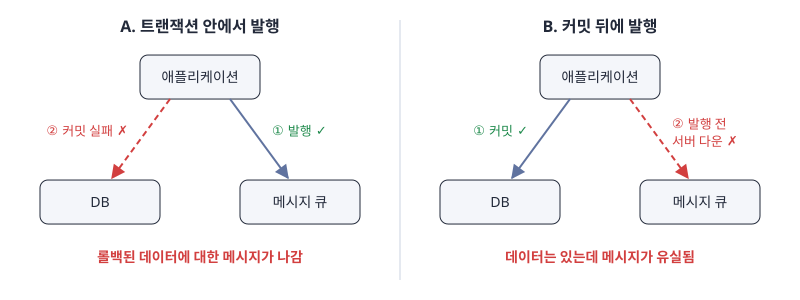

DB에 데이터를 저장하고, 그 사실을 메시지 큐나 외부 API로 알려야 하는 경우는 흔하다. 주문이 확정되면 알림을 보내고, 결제가 끝나면 정산 시스템에 이벤트를 보내는 식이다.

이때 지켜야 할 조건은 두 가지다.

1. 외부 시스템이 느리거나 장애가 나도 DB 트랜잭션에 영향이 없어야 한다.
2. DB에 커밋됐다면 메시지는 반드시 발행돼야 한다. 반대로 롤백됐다면 발행되면 안 된다.

DB와 메시지 큐는 하나의 트랜잭션으로 묶을 수 없다. 서로 다른 두 곳에 쓰기 때문에 한쪽만 성공하는 경우가 생긴다. 이를 **이중 쓰기(dual write) 문제**라고 한다. 이 글은 이 문제를 트랜잭셔널 아웃박스(Transactional Outbox) 패턴으로 푸는 방법을 정리한다. 예시로는 "주문 확정 후 고객에게 알림 발송"을 사용한다.

## 트랜잭션 안에서 바로 발행하면

가장 쉬운 방법은 DB 저장 메서드 끝에서 메시지를 바로 발행하는 것이다. 이렇게 하면 문제가 세 가지 생긴다.

- 외부 호출 응답을 기다리는 동안 DB 커넥션을 계속 잡고 있다.
- 외부 호출이 실패하면 이미 끝난 DB 작업까지 롤백된다.
- 메시지는 나갔는데 이후 커밋이 실패하면, 존재하지 않는 데이터에 대한 메시지가 나간 셈이 된다.

## 커밋 뒤에 발행하면

Spring에서는 `@TransactionalEventListener(phase = AFTER_COMMIT)`으로 커밋이 끝난 뒤에 발행할 수 있다. 위 문제는 해결되지만 새로운 문제가 생긴다. 커밋 직후 서버가 죽으면 "발행해야 한다"는 정보가 메모리에만 있었기 때문에 그대로 사라진다. 데이터는 커밋됐는데 메시지는 영영 나가지 않는다.



결국 "발행해야 한다"는 사실 자체를 **비즈니스 데이터와 같은 트랜잭션 안에서 DB에 저장**해야 한다. 이 저장용 테이블이 아웃박스다. 같은 DB 안이니 하나의 트랜잭션으로 묶을 수 있고, 이중 쓰기가 단일 쓰기로 바뀐다.

## 아웃박스 구조

전체 흐름은 다음과 같다.



**① 커밋 직전에 저장한다.** `BEFORE_COMMIT` 리스너에서 아웃박스 행을 저장하면 비즈니스 데이터와 한 트랜잭션으로 묶인다. 롤백되면 아웃박스 행도 사라지고, 커밋되면 아웃박스 행도 반드시 남는다.

**② 커밋 직후에 큐로 보낸다.** 커밋이 확정된 뒤에만 메시지를 발행한다. 이 시점에 서버가 죽어도 DB에는 PENDING 행이 남아 있다.

**빠진 건 스윕 잡이 줍는다.** 주기적으로 도는 잡이 "만든 지 일정 시간이 지났는데 아직 PENDING인 행"을 찾아 큐에 다시 넣는다. ② 직전에 서버가 죽은 경우가 여기서 복구된다. 너무 오래된 행은 더 처리하지 않고 STALE로 표시해 끝낸다. 알림처럼 시점이 중요한 메시지는 한참 늦게 나가느니 안 나가는 편이 낫기 때문이다. 서버가 여러 대라면 스윕 잡이 동시에 여러 번 돌지 않도록 분산 락이 필요하다. 이 부분은 [ShedLock + Redis로 스케줄링 작업 단일 실행하기](../shedlock-redis-scheduled-job-lock/)에서 다뤘다.

> 아웃박스 행을 큐로 옮기는 방식은 크게 두 가지다. 여기서 쓴 것처럼 애플리케이션이 직접 발행하고 스윕으로 보완하는 폴링 방식, 그리고 Debezium 같은 CDC 도구로 DB 변경 로그를 읽어 발행하는 방식이다. 인프라를 늘리지 않으려고 전자를 택했다.

### BEFORE_COMMIT 리스너의 함정

`BEFORE_COMMIT` 리스너에서 예외가 나면 본 트랜잭션 전체가 롤백된다. 부가 기능인 메시지 준비가 실패했다고 핵심 비즈니스 처리가 취소되면 안 된다. 그래서 리스너 안의 로직은 `runCatching`으로 감싸고, 실패하면 로그만 남긴다.

```kotlin
package com.example.notification.application

@Component
class NotificationOutboxListener(
    private val recipientResolver: RecipientResolver,
    private val outboxRepository: NotificationOutboxRepository,
) {
    @TransactionalEventListener(phase = TransactionPhase.BEFORE_COMMIT)
    fun stage(event: OrderConfirmedEvent) {
        runCatching { recipientResolver.resolve(event) }
            .onSuccess { targets -> outboxRepository.saveAll(targets.map(NotificationOutbox::pending)) }
            .onFailure { log.warn("outbox staging skipped: {}", event.orderId, it) }
    }
}
```

메시지 내용을 만드는 로직(여기서는 수신자 판정)은 순수 함수로 분리해 단위 테스트로 고정했다. 리스너에서 실패할 가능성 자체를 줄이기 위해서다.

## 컨슈머: 같은 메시지가 두 번 와도 괜찮게

SQS를 비롯한 대부분의 메시지 큐는 같은 메시지를 두 번 이상 전달할 수 있다(at-least-once). 스윕 잡이 다시 넣은 메시지와 원래 메시지가 겹칠 수도 있다. 아웃박스는 "최소 한 번 발행"을 보장할 뿐 "정확히 한 번"을 보장하지 않는다. 그래서 컨슈머가 중복을 전제로 멱등하게 동작해야 한다.

- 메시지를 받으면 먼저 아웃박스 행 상태를 본다. PENDING이 아니면 이미 처리된 것이므로 그냥 넘긴다.
- 상태는 조건부로 갱신한다.

```sql
UPDATE notification_outbox
SET status = 'SENT'
WHERE id = ? AND status = 'PENDING';
```

두 컨슈머가 동시에 같은 행을 처리해도 이 쿼리는 한 번만 성공한다. 처리 기록이 두 번 남지 않는다.



- 처리 방법을 모르는 예외는 억지로 재시도하지 않는다. 큐의 재전달 횟수를 넘기면 DLQ(Dead Letter Queue)로 보내고 사람이 확인한다.

## 정리

- DB 저장과 메시지 발행은 하나의 트랜잭션으로 묶을 수 없어서, 한쪽만 성공하는 이중 쓰기 문제가 생긴다.
- 트랜잭션 안에서 발행하면 느려지고 실패가 번진다. 커밋 뒤에 발행하면 그 사이 서버가 죽을 때 메시지가 사라진다.
- 아웃박스는 "발행해야 한다"는 사실을 비즈니스 데이터와 같은 트랜잭션에 저장해 이 틈을 막는다. 실제 발행은 커밋 뒤에 하고, 놓친 건 스윕 잡이 다시 줍는다.
- 아웃박스가 보장하는 건 at-least-once다. 컨슈머는 상태 확인과 조건부 갱신으로 같은 메시지를 여러 번 받아도 결과가 같게 만든다.
