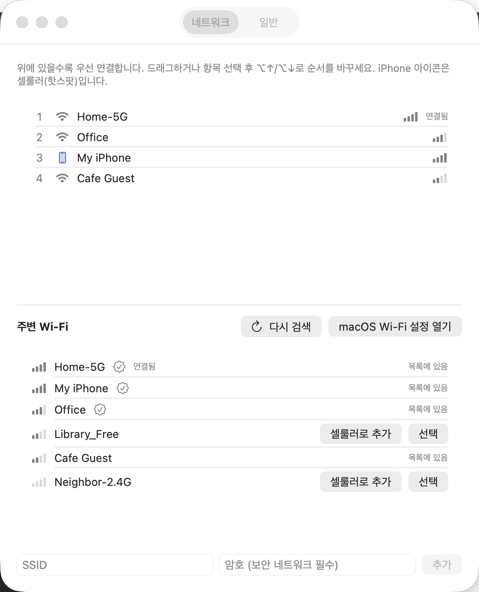

**인터넷이 끊기지 않게 지켜 주는 macOS 메뉴바 앱입니다.** Wi-Fi에는 붙어 있는데 인터넷이 안 될 때, NetKeeper가 다음 Wi-Fi나 iPhone 핫스팟으로 알아서 넘어갑니다.

## 이런 분께

- 카페·사무실 Wi-Fi가 자주 끊겨 손으로 핫스팟을 켜던 분
- 화상 회의나 원격 작업 중에 연결이 끊기면 곤란한 분
- 여러 Wi-Fi와 iPhone 핫스팟을 오가며 일하는 분

## 주요 기능

- **우선순위 자동 전환**: Wi-Fi와 iPhone 핫스팟을 하나의 목록으로 관리합니다. 인터넷이 실제로 끊기면 다음 순위로 넘어가고, 상위 네트워크가 돌아오면 다시 옮겨 갑니다.
- **실제 인터넷 확인**: Wi-Fi 연결 여부가 아니라 인터넷이 정말 되는지를 몇 초마다 확인합니다.
- **iPhone 핫스팟 연결**: 대기 중인 iPhone도 macOS Wi-Fi 메뉴처럼 깨워서 연결합니다.
- **최근 60분 기록**: Wi-Fi·셀룰러·끊김 구간과 전환 횟수를 메뉴바에서 바로 봅니다.
- **메뉴바에서 바로 조작**: 클릭하면 연결하고, 우클릭하면 우선순위를 바꿉니다. macOS에 저장된 Wi-Fi는 암호를 다시 넣지 않아도 됩니다.

Wi-Fi 암호는 macOS 키체인에만 저장하고, 인터넷 확인 외에는 어떤 데이터도 보내지 않습니다. 한국어와 영어를 지원합니다.

## 화면

## 써 보기

macOS 15 이상에서 동작하며, 무료·오픈 소스(MIT)입니다. 지금은 [GitHub 저장소](https://github.com/zzaisang/netkeeper)에서 소스를 받아 빌드해 쓸 수 있습니다.
