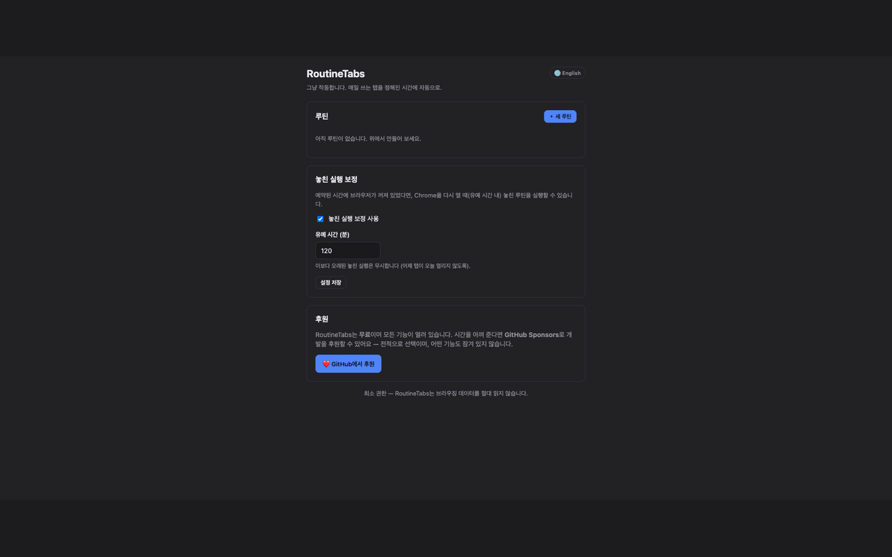

**매일 여는 탭을, 정한 시간에 알아서 열어 드립니다.** RoutineTabs는 메일·캘린더·대시보드처럼 매일 쓰는 탭 세트를 요일·시간에 맞춰 자동으로 여는 Chrome 확장입니다.

## 이런 분께

- 출근하면 같은 탭 대여섯 개를 매번 손으로 여는 분
- 요일마다 보는 도구가 달라 아침 준비가 번거로운 분
- 예약 확장을 꺼도 탭이 계속 열려 불편했던 분

## 주요 기능

- **루틴 한 번이면 끝**: 이름, URL 목록, 요일·시간만 정하면 그 시간에 탭 세트를 새 탭이나 새 창으로 엽니다. "평일 오전 9시: 메일 + 캘린더 + 대시보드" 같은 식입니다.
- **끄면 진짜 꺼짐**: 토글을 끈 루틴은 확실히 멈춥니다.
- **서머타임에도 정확**: 서머타임 전환이 있어도 정한 시각이 밀리지 않습니다.
- **놓친 실행 따라잡기**: 예약 시간에 Chrome이 닫혀 있었다면, 다시 열 때 직접 정한 유예 시간 안에서 놓친 루틴을 엽니다.
- **지금 실행**: 버튼 하나로 루틴을 바로 엽니다.

모든 기능이 무료이고 잠긴 기능이 없습니다. 권한은 `alarms`·`storage` 두 개만 쓰며 브라우징 데이터를 읽지 않고, 루틴은 기기 밖으로 나가지 않습니다. 다크 모드와 한국어·영어 전환을 지원합니다.

## 화면

## 설치하기

[Chrome 웹 스토어에서 RoutineTabs 설치하기](https://chromewebstore.google.com/detail/routinetabs/jhkpnjoakkeimnelcpfoaofckpjlkmdo) · 소스는 [GitHub](https://github.com/zzaisang/routinetabs)에 공개되어 있습니다.
